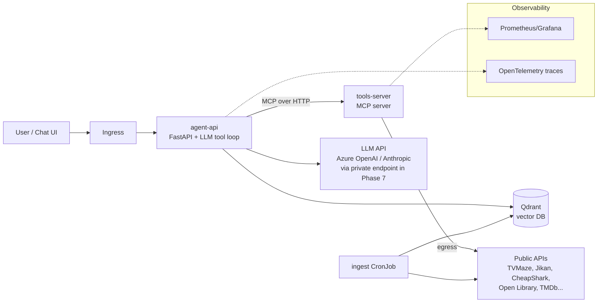

# Project Plan: "Watch Party" — an Entertainment Concierge Agent on Kubernetes

A hands-on learning project for moving from cloud engineering toward AI Engineer / AI Platform Engineer work.

The agent answers questions like *"I've got 3 hours tonight, I liked Arcane, what should I watch or play?"* To do that it calls free public APIs (TV, anime, games, books, trivia) as tools and searches its own vector index for "something like X" questions. Everything runs on Kubernetes. The project starts on a local cluster, moves through GitOps, and finishes as a private, locked-down AI platform on Azure.

---

## Target roles and the thesis of this project

Roles this is aimed at (all seen hiring in NYC as of Oct 2026):

- **AI Platform Engineer / AI Infrastructure Engineer, VP** — JPMorgan GTAR, Morgan Stanley, BlackRock, PJT Partners. Kubernetes running AI workloads, Terraform, Python, self-service tooling, governance and controls.
- **AI/Cloud Infrastructure Engineer** — Bloomberg, Cisco. Kubernetes-as-a-service, IaC, MLOps pipelines.
- **Forward Deployed AI Engineer** — Deloitte, Insight Global/asset managers, PwC. Azure AI Foundry, AKS, agent workflows, client-facing delivery.

**The thesis:** the differentiator is not "I learned Kubernetes." Plenty of candidates have that. It's **"I build secure, private AI platforms for regulated environments"** — which combines the agent/RAG skills this project teaches (Phases 1–4) with the Azure, Terraform and private-networking skills already on the resume (Phase 7).

Phases 0–6 are the new material. Phase 7 is where existing strengths become the capstone, and it is the part to invest most in.

### How the phases map to what postings ask for

| What the postings keep asking for | Where it's covered |
|---|---|
| Kubernetes running AI workloads | Phases 0, 2, 3, 4 |
| Agent / tool calling / LLM orchestration | Phases 1, 3 |
| RAG, embeddings, vector stores | Phase 4 |
| Evals, LLMOps, model/cost observability | Phases 1, 5, 6 |
| GitOps, declarative delivery | Phase 5 |
| Terraform / IaC | Phase 7 |
| Secure networking, egress control, private connectivity | Phases 6, 7 |
| Identity, secrets, RBAC, governance | Phases 6, 7 |
| GPU scheduling, self-hosted inference | Side exercise (below) |

---

## Scope discipline — read this before adding anything

The core path below is what grows the skill set. Everything else lives in **"Only if curious"** at the bottom and should be skipped by default. A finished Phase 7 beats a half-built Phase 6 with a Gateway API bolted on.

**Core path:**

- **Phase 0** — ✅ done
- **Phases 1–4** — the agent/AI-engineer half. The real new material. Don't rush these.
- **Phase 5 (trimmed)** — Argo CD and the pull-based GitOps model. CI itself is already familiar from Azure DevOps, so don't linger on GitHub Actions syntax.
- **Phase 6 (trimmed)** — NetworkPolicies, basic metrics and traces, guardrails, RBAC + quotas. Nothing else.
- **Phase 7** — the capstone. Private AKS, private endpoints, Workload Identity, Key Vault, egress control, all through Terraform.

---

## Why this domain works

- **No cloud resources needed.** The data comes from free public APIs, so the agent is useful from day one.
- **Real tool-calling problems.** Each API has its own JSON shape and some have rate limits. Some will be down. Handling that is exactly what agent work looks like in practice.
- **A natural RAG use case.** Questions like "shows like X but darker" are semantic search over show and anime synopses.
- **Infrastructure you actually need.** Outbound egress to external APIs means you'll deal with DNS, NetworkPolicies, and retries for real reasons — and it sets up the private-egress story in Phase 7.
- **Easy to demo.** Anyone can ask it a question in an interview.

---

## End-state architecture



---

## API shortlist

These were picked from the public-apis README (Entertainment, Video, Anime, Games & Comics, and Books sections). Most need no key, which keeps the early phases simple.

| API | Use in the agent | Auth | Notes |
|---|---|---|---|
| **TVMaze** (`api.tvmaze.com`) | Search shows, episodes, schedules | None | Very reliable. Use this for your first tool |
| **Jikan** (`api.jikan.moe`) | Anime search, top anime, synopses | None | Rate limited, so it's a good lesson in backoff |
| **CheapShark** (`cheapshark.com/api`) | PC game deals and prices | None | Simple, clean JSON |
| **FreeToGame** (`freetogame.com/api`) | Free-to-play game catalog by genre/platform | None | Good for filter-style parameters |
| **Open Library** (`openlibrary.org`) | Book search, subjects | None | Good alternative domain for the RAG index |
| **Open Trivia DB** (`opentdb.com`) | Trivia questions | None | Fun "quiz me about X" tool |
| **JokeAPI** (`v2.jokeapi.dev`) | Jokes with category filters | None | Trivial. Good first MCP tool |
| **xkcd** (`xkcd.com/info.0.json`) | Comics | None | Trivial |
| **MusicBrainz** | Artist/album lookup | None | Requires a User-Agent header and about 1 request/sec. Good lesson in respecting API rules |
| **TMDb** | Movie data | Free API key | Add in Phase 3 to practice Kubernetes Secrets for a third-party key |

> Many entries in that list are dead, especially anything hosted on `herokuapp.com`, which lost its free tier. Before writing a tool, test the API with `curl`. Every tool should also return a clean error message the LLM can reason about ("service unavailable, try another source") instead of crashing.

---

## Tooling choices

| Concern | Choice | Why |
|---|---|---|
| Local cluster | **kind** | Disposable, cheap, standard in tutorials |
| Language | Python 3.12 + FastAPI | Already your strength |
| LLM | Azure OpenAI (lines up with AI-103) or the Anthropic API | Either works. Keep it behind one small **OpenAI-compatible** client class so swapping — including to a self-hosted model — is trivial |
| Agent framework | **Hand-written tool loop first**, LangGraph or Semantic Kernel later | You learn what frameworks hide |
| Tool protocol | MCP (Python MCP SDK, streamable HTTP) | Industry direction, and it gives you a second service to deploy |
| Embeddings | `fastembed` (local, free) or Azure OpenAI embeddings | No cost while learning |
| Vector DB | Qdrant (official Helm chart) | Simple, runs well in a cluster. Swapped for Azure AI Search in Phase 7 |
| CI | GitHub Actions + GHCR | Public portfolio. The same concepts map 1:1 to Azure DevOps |
| GitOps | Argo CD | Most common in job postings, and the UI helps while learning |
| Observability | kube-prometheus-stack + OpenTelemetry | Standard stack |
| Ingress | Plain Ingress (ingress-nginx) | Gateway API is nicer but is not worth the detour — see "Only if curious" |

---

## Repo layout (monorepo)

```
watch-party/
├── apps/
│   ├── agent-api/          # FastAPI, agent loop, LLM client
│   ├── tools-server/       # MCP server wrapping public APIs
│   └── ingest/             # embedding/ingestion job
├── charts/
│   ├── agent-api/
│   ├── tools-server/
│   └── ingest/
├── gitops/                 # what Argo CD watches (values per env, app-of-apps)
│   ├── apps/
│   └── envs/local/
├── infra/                  # Phase 7: Terraform root module for private AKS
├── evals/                  # question set + expected tool calls
├── docs/
│   ├── decisions.md        # one paragraph per choice — interview prep
│   ├── benchmarks.md       # the one small benchmark doc
│   ├── operational-readiness.md
│   └── runbooks/
├── kind-config.yaml
├── Makefile                # make up / make down / make deploy
└── README.md
```

---

## The phases

Each numbered step is sized for one work session. Check it off when you can show the "done when" result.

### Phase 0 — Kubernetes fundamentals (no AI yet) ✅ COMPLETE

**Goal:** be comfortable with the core objects before mixing in agent complexity.

- [x] Install Docker, kind, kubectl, helm, and k9s (k9s is optional but very helpful)
  - Docker 29.1.3, kind 0.31.0, kubectl v1.35.0, helm v4.0.4 were already installed. Installed k9s v0.51.0 via `brew install derailed/k9s/k9s`.
- [x] `kind create cluster --config kind-config.yaml`. Then delete it and recreate it to get used to the cluster being disposable
  - Created `kind-config.yaml` at repo root: single control-plane node, cluster name `watch-party`.
  - Gotcha: Docker Desktop must be running (the app, not just the CLI) before `kind create cluster` — first attempt failed with "Cannot connect to the Docker daemon ... Is the docker daemon running?" because the Desktop app wasn't open. Opened Docker Desktop, then the create succeeded.
  - `kubectl cluster-info` showed the API server and CoreDNS reachable at a `127.0.0.1:<random-port>` URL — kind runs the whole single-node cluster inside one Docker container and exposes that container's API server port to the host; this is written into `~/.kube/config` under context `kind-watch-party`, which is why bare `kubectl` commands work without `--context`. CoreDNS is the cluster's internal DNS, used later for service-to-service name resolution (Phase 3).
  - `kubectl get nodes` showed one `Ready` node `watch-party-control-plane`.
  - Deleted with `kind delete cluster --name watch-party`; confirmed gone when `kubectl get nodes` errored with "connection refused" on `localhost:8080` (kubeconfig had no valid current context left, falling back to the old default address). Recreated with the same `kind create cluster --config kind-config.yaml` and confirmed `Ready` node again.
- [x] Write a tiny FastAPI app with `/healthz` and `/hello`, then containerize it
  - Created `apps/hello/` with `main.py` (two routes: `/healthz` → `{"status":"ok"}`, `/hello` → greeting message), `requirements.txt` (`fastapi`, `uvicorn[standard]`), and a simple single-stage `Dockerfile` (`python:3.12-slim`, copies requirements first for layer caching, `CMD uvicorn main:app --host 0.0.0.0 --port 8000`). Multi-stage/non-root hardening deferred to Phase 2 per the plan.
  - Verified locally first with a venv (`uvicorn main:app --reload`, default bind `127.0.0.1:8000`) and `curl localhost:8000/healthz` / `/hello` — both returned correctly.
  - Built the image (`docker build -t hello:v1 .`) and ran it (`docker run -p 8080:8000 hello:v1`). Confirmed `curl localhost:8080/healthz` and `/hello` both work, while `curl localhost:8000/...` and `curl 0.0.0.0:8000/...` correctly fail — port 8000 only exists inside the container's own network namespace; `-p 8080:8000` is the one forwarding rule that tunnels traffic from the host's 8080 into the container's 8000, and that's the only path in.
  - Key lesson: `--host 0.0.0.0` in the Dockerfile CMD is required so uvicorn listens on all interfaces inside the container (not just the container's own loopback), which is what allows Docker's port mapping (and later, Kubernetes Services) to route traffic in at all. The uvicorn startup log (`Uvicorn running on http://0.0.0.0:8000`) only reports what the process bound to inside its own namespace — it says nothing about whether/how anything outside the container can reach it; that forwarding is a separate concern (Docker `-p`, or later a K8s Service) layered on top.
- [x] Load the image into kind (`kind load docker-image`) and deploy with **raw YAML**: Deployment, Service, ConfigMap (greeting text), Secret (fake key)
  - Created `apps/hello/k8s/{configmap,secret,deployment,service}.yaml`. ConfigMap holds `GREETING`; Secret (`stringData`) holds a fake `FAKE_API_KEY`; Deployment (1 replica, `image: hello:v1`, `imagePullPolicy: IfNotPresent`) injects both as env vars via `configMapKeyRef`/`secretKeyRef`; Service is `ClusterIP` mapping `port: 80` → `targetPort: 8000`.
  - `kind load docker-image hello:v1 --name watch-party` was required before `kubectl apply` — kind nodes run their own isolated container runtime and don't automatically see images built in Docker Desktop; without loading, the pod would fail to pull `hello:v1` (no registry configured).
  - `kubectl apply -f k8s/` created all 4 objects; `kubectl get pods` showed `1/1 Running`.
  - `ClusterIP` (the default Service type) only gives an address reachable *from inside* the cluster — `EXTERNAL-IP` was `<none>` by design, which is why `kubectl port-forward` was needed to reach it from the Mac at all for this bullet.
  - Verified env injection with `kubectl exec <pod> -- env | grep ...` (note: `-it` + piping to `grep` triggers a kubectl TTY-handling crash/panic — drop `-it` when not running an interactive shell).
  - `kubectl port-forward svc/hello 8080:80` logged `Forwarding from 127.0.0.1:8080 -> 8000` — port-forward resolves the Service's `targetPort` and connects straight to the pod, bypassing the Service's own `port: 80` proxy (that proxying only matters for in-cluster traffic).
  - Added a `/test_config` route reading `os.getenv('GREETING')` to prove the ConfigMap was actually wired through. Confirmed the local dev loop needed to pick up code changes with no registry/volume mount in play: rebuild image (`docker build`) → reload into kind (`kind load docker-image`) → `kubectl rollout restart deployment/hello` (needed because the image tag doesn't change, so Kubernetes has no other signal to replace the running pod) → re-run `port-forward` against the new pod. `curl localhost:1333/test_config` returned `{"message":"This is from the ConfigMap: Hello from the ConfigMap!"}`, confirming the full ConfigMap → Deployment → container → app chain.
- [x] Break it on purpose: a wrong image tag, a crashing app, a bad port. Debug with `kubectl describe`, `logs`, `get events`
  - **Wrong image tag:** set `image: hello:v10` (never built/loaded). Pod showed `STATUS ErrImagePull` → `ImagePullBackOff`. `kubectl describe pod` and `kubectl get events --sort-by=.lastTimestamp` both showed the root cause: kubelet tried `docker.io/library/hello:v10` and got `pull access denied, repository does not exist`, since no registry was configured and the tag was never loaded into kind.
  - Confirmed the Deployment → ReplicaSet → Pod ownership chain directly in the events (`deployment/hello` → `ScalingReplicaSet` → `replicaset/...` → `SuccessfulCreate` → `pod/...`). Also observed Kubernetes' rolling-update safety behavior: the old healthy pod was left running the whole time the new (broken) pod failed to pull, so the bad rollout never took down the working service.
  - **Crashing app:** added `sys.exit(1)` at the top of `main.py` to force an immediate startup crash, rebuilt/reloaded/restarted. Pod cycled `Running` → `Error` → `CrashLoopBackOff`, with `Restart Count` climbing and a `BackOff` event ("Back-off restarting failed container") showing Kubernetes' exponential restart-delay policy. `kubectl logs` came back **empty** — `sys.exit(1)` doesn't print anything, unlike an unhandled exception which would write a traceback to stderr before dying. Lesson: a bad exit code alone doesn't explain *why* without the app itself logging something first.
  - **Bad port:** changed the Deployment's `containerPort` from `8000` to `8080` (app still actually listens on 8000 per the Dockerfile `CMD`). Pod still came up `Running`/healthy, and `port-forward` + `curl` still worked — confirming `containerPort` is purely declarative metadata with no effect on actual traffic routing when the Service's `targetPort` references a port number directly. It would matter if a Service referenced a *named* port, or for NetworkPolicies/tooling that read it as the source of truth. Reverted `containerPort` back to `8000` afterward to keep the manifest accurate.
  - General takeaway: `kubectl describe pod` and `kubectl get events --sort-by=.lastTimestamp` show overlapping but differently-scoped information — `describe` is deep but scoped to one object (plus its recent events), `get events` is shallower per-item but spans the whole namespace/cluster chronologically, useful when you don't yet know which object is at fault.
- [x] Add liveness and readiness probes and resource requests/limits
  - Added `livenessProbe` and `readinessProbe` (both `httpGet` on `/healthz:8000`, `initialDelaySeconds: 3`, `periodSeconds: 5`) plus `resources` (requests `50m`/`64Mi`, limits `200m`/`128Mi`) to the container spec in `deployment.yaml`.
  - `describe` showed Kubernetes filling in probe defaults not specified: `timeout=1s #success=1 #failure=3` — so it takes 3 consecutive failures (~15s here) before a probe is considered failed, not one bad response.
  - Setting resources flipped the pod's `QoS Class` from `BestEffort` to `Burstable`. QoS is derived from what you set: `Guaranteed` (requests == limits everywhere), `Burstable` (requests set but below limits), `BestEffort` (nothing set). Under node memory pressure the kubelet evicts `BestEffort` first, then `Burstable`, `Guaranteed` last — so resources affect survivability, not just scheduling.
  - **Liveness vs readiness, demonstrated:** pointed only the readiness probe at a bogus path (`/not-real`) while leaving liveness on `/healthz`. Result: pod stayed `STATUS Running` with `RESTARTS 0` but `READY 0/1`, and `describe` logged `Warning Unhealthy ... Readiness probe failed: HTTP probe failed with statuscode: 404`. Readiness failure pulls a pod out of Service traffic; it never restarts the container. (Liveness failure is what triggers a restart.)
  - **Readiness gates rolling updates** — the most valuable practical takeaway. The rollout stalled with both pods alive: the old `1/1` pod was kept because the new one never became ready, so the broken version never took over and the Service kept serving. Same protective pattern as the bad-image-tag case.
  - Gotcha: `kubectl get endpointslices` default output lists *all* addresses in the `ENDPOINTS` column regardless of readiness, which is misleading. Readiness lives per-address in `conditions.ready`, only visible via `-o yaml`. Confirmed one endpoint `ready: true` (old pod) and one `ready: false` (new pod) during the broken rollout.
  - Tested Service routing from inside the cluster with a throwaway pod: `kubectl run curl-test --rm -i --image=curlimages/curl --restart=Never -- curl -s http://hello/healthz` (hits the Service's `port: 80` by DNS name, exercising real CoreDNS + Service routing rather than bypassing it like `port-forward` does).
  - Forced the Service fully dark by deleting the old ReplicaSet (`kubectl delete rs <old>`) — the Deployment controller keeps old ReplicaSets for rollback history but does not recreate a deleted one, so the last ready pod went away. The in-cluster curl then showed `Host hello:80 was resolved. IPv4: 10.96.234.155 ... Connection refused` — DNS resolves and the ClusterIP exists, but with zero ready endpoints kube-proxy refuses immediately rather than timing out. Useful symptom to recognize. (Deleting old ReplicaSets discards rollback history — fine for a throwaway app, not a casual production move.)
  - Reverted the readiness path to `/healthz`; back to a single `1/1 Running` pod with one `ready: true, serving: true` endpoint.
- [x] Convert the YAML into a Helm chart with `values.yaml`. Deploy with `helm install`, change a value, then `helm upgrade` and `helm rollback`
  - Built `charts/hello/` with `Chart.yaml`, `values.yaml`, and `templates/{deployment,service,configmap,secret}.yaml`. Everything previously hardcoded (replica count, image repo/tag/pullPolicy, service ports, greeting, fake key, resources) became a value. `Chart.yaml`'s `version` (chart version) and `appVersion` (app version) are deliberately independent.
  - Templating notes: `.Values` reads `values.yaml`; `.Release.Name` comes from `helm install <name>` and is used in object names so the chart can be installed more than once without collisions; `.Chart.Name` comes from `Chart.yaml`. `| quote` prevents YAML from coercing string values like `yes`/`1.0` into bools/floats. `{{- toYaml .Values.resources | nindent 12 }}` serializes a whole nested map and indents it to land correctly, letting users override the entire block without the template knowing its shape.
  - Helm refuses to adopt resources it didn't create, so the raw-YAML objects had to be removed first (`kubectl delete -f apps/hello/k8s/`) or `helm install` fails with an ownership-metadata error.
  - Used `helm lint` and `helm template hello ./charts/hello` to render locally and eyeball the output (especially indentation) before touching the cluster. Then `helm install hello ./charts/hello` → `REVISION: 1`, pod `1/1 Running`.
  - **Stale ConfigMap gotcha:** changing `config.greeting` and running `helm upgrade` updated the ConfigMap object but the app still served the old value. A Deployment only rolls pods when its *pod template* changes; a ConfigMap is a separate object, so the template was byte-identical and the controller correctly did nothing — and the running container had its env injected once at startup. Fixed properly with the standard checksum-annotation idiom on `spec.template.metadata.annotations`: `checksum/config: {{ include (print $.Template.BasePath "/configmap.yaml") . | sha256sum }}`. The annotation is functionally inert; it exists so a ConfigMap content change produces a different pod template and therefore a real rollout. (`kubectl rollout restart` is the manual equivalent.)
  - **Rollback semantics:** `helm rollback hello 1` did not reset the revision counter to 1 — it appended a *new* revision 4 described as `Rollback to 1`. Helm's history is append-only, same philosophy as `git revert` vs `git reset`. A revision is a snapshot of the complete rendered manifest set, not a diff, so rolling back reverted the greeting *and* removed the checksum annotation together.
  - Neat detail: the rolled-back pod reused the original ReplicaSet (`hello-6594fb5757-...`) because Kubernetes names ReplicaSets by hashing the pod template, and the restored template was identical to revision 1's. Helm's revision history and the Deployment's ReplicaSet history are independent systems that happened to line up.
  - Also set up VS Code for chart editing: `ms-kubernetes-tools.vscode-kubernetes-tools` (registers a `helm` language mode that tolerates Go templating inside `.yaml`) plus a `"files.associations": {"**/templates/*.yaml": "helm"}` setting; optionally `tim-koehler.helm-intellisense` for `.Values.*` autocomplete.

**Concepts:** pods, deployments, ReplicaSets, services, labels/selectors, probes, ConfigMaps vs Secrets, Helm templating.
**Done when:** `helm install hello ./charts/hello` works and `kubectl port-forward` reaches it. ✅ Verified — `helm install hello ./charts/hello` deployed cleanly and `kubectl port-forward svc/hello 8080:80` + `curl localhost:8080/hello` returned the app's response.

---

### Phase 1 — Agent v1, running locally in plain Python

**Goal:** understand tool calling from first principles. No Kubernetes in this phase.

- [ ] Build an LLM client wrapper. One class with `chat(messages, tools)`. **Speak the OpenAI-compatible chat-completions API** — Azure OpenAI, many gateways, and self-hosted servers like vLLM all expose it, so the only thing that ever changes is a base URL and a key. Anthropic goes behind the same interface via a thin adapter
- [ ] Write 3 tools as plain Python functions with JSON schemas: `search_tv_shows` (TVMaze), `find_game_deals` (CheapShark), `search_books` (Open Library)
- [ ] Hand-write the agent loop: send a message, run any tool calls the LLM requests, feed the results back, and repeat until a final answer or `max_steps`
- [ ] Trim API responses before returning them to the LLM, keeping only the fields it needs. This is a big lesson in token cost
- [ ] Log every step: the tool name, arguments, latency, and tokens used
- [ ] Create `evals/questions.yaml` with 10 questions and the tool(s) you expect each to use. Write a small script that runs them and reports pass/fail

**Concepts:** tool schemas, the agent loop, context management, failure handling, basic evals.
**Done when:** `python -m agent "find me a cheap co-op game and a show to watch after"` uses 2 tools correctly, and the eval script runs.

### Phase 2 — Containerize the agent and run it in the cluster

**Goal:** your agent is a real Kubernetes workload.

- [ ] Wrap the agent in FastAPI: `POST /chat`, `GET /healthz`
- [ ] Use a multi-stage Dockerfile with a slim base image, running as non-root
- [ ] Write the Helm chart: Deployment, Service, a ConfigMap for the model name and max steps, and a Secret for the LLM API key, created with `kubectl create secret` and **never committed**
- [ ] Deploy to kind and call it via port-forward
- [ ] Scale to 3 replicas and watch requests spread across them in the logs

**Concepts:** 12-factor config, secret handling, stateless services, scaling.
**Done when:** `curl localhost:8080/chat -d '{"message":"..."}'` returns an answer from inside the cluster.

### Phase 3 — Split tools into an MCP server (microservices + cluster DNS)

**Goal:** two services that talk over the cluster network, plus a real agent protocol.

- [ ] Move the tools into `tools-server` as an MCP server using the Python MCP SDK over streamable HTTP
- [ ] Add more tools: Jikan anime, FreeToGame, Open Trivia, JokeAPI
- [ ] Add TMDb with a free API key. It goes in a second Secret that only `tools-server` mounts, which is least-privilege at the pod level
- [ ] Have `agent-api` discover tools from the MCP server at startup, reached at `http://tools-server.watch-party.svc.cluster.local`
- [ ] Debug DNS deliberately: `kubectl run -it debug --image=busybox -- nslookup tools-server`. Then look at how CoreDNS resolves both internal names and external ones like `api.tvmaze.com`
- [ ] Add timeouts, retries with backoff, and clean error messages to every tool

**Concepts:** service discovery, cluster DNS, MCP, separation of concerns, per-service secrets.
**Done when:** you can add a new tool by changing only `tools-server`, and the agent picks it up after a redeploy.

### Phase 4 — RAG: a vector index of shows, anime, and books

**Goal:** handle "something like X" questions that keyword APIs can't answer.

- [ ] Install Qdrant via its Helm chart. Look at the StatefulSet and PersistentVolumeClaim it creates
- [ ] Write an `ingest` job that pulls a few thousand TVMaze shows (paginated `/shows` endpoint), top anime from Jikan, and a few Open Library subjects. It cleans and chunks the synopses, embeds them with `fastembed`, and upserts them with metadata (genre, year, rating, source)
- [ ] Run it first as a Kubernetes **Job**, then as a weekly **CronJob**
- [ ] Add a `semantic_search` tool to the agent with metadata filters, e.g. `type=anime`, `year>2015`
- [ ] Extend the evals with 5 "similar to X" questions
- [ ] Delete the Qdrant pod and confirm the data survives through the PVC

**Concepts:** embeddings, chunking, metadata filtering, hybrid answers (RAG + live APIs), StatefulSets, PVCs, Jobs/CronJobs.
**Done when:** "anime like Cowboy Bebop but newer" returns sensible results that came from the vector index.

### Phase 5 — GitOps with Argo CD (trimmed)

**Goal:** stop running `helm install` by hand. Git becomes the source of truth.

> **Trim note:** CI itself is already familiar territory from Azure DevOps. Build the pipeline, but don't sink sessions into GitHub Actions syntax. The genuinely new idea here is **pull-based deployment** — a controller inside the cluster reconciling against Git, rather than a pipeline pushing changes in. That's the part to understand deeply.

- [ ] GitHub Actions on push: lint, unit tests, build images, push to GHCR tagged with the commit SHA. Keep it simple
- [ ] Install Argo CD in kind. Create an app-of-apps in `gitops/` that deploys all three charts plus Qdrant
- [ ] Have CI open a commit (or PR) that bumps the image tag in `gitops/envs/local/`. Argo CD then syncs the change
- [ ] Add the eval script as a CI step that fails the build if pass rate drops below a threshold
- [ ] Practice drift: `kubectl edit` a deployment by hand and watch Argo revert it
- [ ] Practice rollback by reverting the Git commit
- [ ] Write the "why GitOps" paragraph in `docs/decisions.md` — specifically, how pull-based reconciliation differs from the push model you already use, and what that buys you in a regulated environment (no cluster credentials in the pipeline, Git as the audit trail)

**Concepts:** push vs pull deployment, declarative state, drift detection, evals as a quality gate.
**Done when:** a merged PR changes what's running in the cluster without you touching kubectl.

### Phase 6 — Security, observability and guardrails (trimmed)

**Goal:** the platform-engineering layer that most portfolios skip — but only the parts that matter for these roles.

**In scope — do these four:**

- [ ] **NetworkPolicies:** recreate the kind cluster with Calico, since kind's default networking doesn't enforce policies. Then set default-deny, and allow agent → tools-server, agent → Qdrant, and tools-server → internet egress on 443 plus DNS on 53. Verify that agent-api *cannot* reach the internet directly. This is the local rehearsal for Phase 7's private-cluster egress story
- [ ] **RBAC and quotas:** give each workload its own ServiceAccount with least privilege. Add a `ResourceQuota` and `LimitRange` per namespace, and prove it by trying to deploy something that exceeds the quota. This is the "multi-tenant platform" muscle every AI platform posting asks for
- [ ] **Metrics and traces:** install kube-prometheus-stack and expose custom metrics — tool calls per API, error rate, LLM tokens, and estimated cost per request. Add OpenTelemetry to both services so one trace shows the whole chain (user request → LLM call → tool call → external API). **Token and cost visibility is the thing that distinguishes "LLM observability" from ordinary APM** — make sure that metric is real and on a Grafana panel
- [ ] **Guardrails:** limit max steps and max tokens per request, validate tool inputs, and add a basic prompt-injection check, since API data is untrusted text going into the prompt

**Also, cheap and worth it:**

- [ ] Write `docs/operational-readiness.md` — a short checklist the agent has to pass before it's considered live (probes defined, resource limits set, dashboard exists, alert exists, runbook exists, secrets not in Git, rollback path tested)
- [ ] Write two runbooks in `docs/runbooks/` — e.g. "tools-server is returning 5xx" and "eval pass rate dropped after a deploy". Short, numbered, with the actual commands

**Explicitly out of scope here:** Gateway API, cert-manager, Redis caching, HPA and load testing. See "Only if curious".

**Concepts:** zero-trust networking, egress control, multi-tenancy, LLM observability and cost visibility, AI security basics, operational readiness.
**Done when:** a Grafana dashboard shows requests, tool usage and token cost; a NetworkPolicy test proves agent-api can't reach the internet directly; and the readiness checklist is written and honestly passable.

### Phase 7 — The capstone: a private AI platform on Azure

**Goal:** this is the differentiator. Phases 1–6 teach things you don't have yet; **this phase is where four years of Azure, Terraform and private-network engineering become the thing nobody else in the candidate pool has.**

Most people building agent portfolios deploy to a public endpoint and stop. The bank and asset-manager roles are not hiring for that — they're hiring for *"can you run this in an environment where nothing is allowed to touch the public internet and every control has to be evidenced."* That's already your day job. Put it on display.

**The pitch this phase earns:** *"I build secure, private AI platforms for regulated environments."*

- [ ] In `infra/`: a single Terraform root module with a resource group, a **private AKS cluster** (one small node pool, autoscale 0–2), ACR, and a VNet with proper subnet segmentation. Remote state backend
- [ ] **Private endpoints for everything:** Azure OpenAI, Azure AI Search, ACR and Key Vault all reached over Private Link with public network access disabled. Private DNS zones wired up so in-cluster name resolution lands on the private IPs. This is the centerpiece — get it working and document it
- [ ] **Workload Identity + Key Vault CSI driver** so no secrets are stored in the cluster at all. Federated credentials, not service principal secrets
- [ ] **Egress control:** the public APIs still have to be reachable, so reason through and implement it properly — NAT Gateway or Azure Firewall with an FQDN allowlist for `api.tvmaze.com` and friends, and nothing else. Write up the design decision; it's a great interview answer
- [ ] **Swap Qdrant for Azure AI Search** behind the same `semantic_search` interface (this is why the tool interface was kept clean). Point the LLM client at Azure OpenAI via its private endpoint. Both swaps should be configuration, not rewrites
- [ ] Point CI at ACR, and bootstrap Argo CD on AKS from the same `gitops/` repo, adding an `envs/aks/` overlay
- [ ] **Build the pipeline in Azure DevOps**, not just GitHub Actions. It maps directly to the day job and to what these teams actually run
- [ ] Write `docs/decisions.md` entries for the private-networking choices — why private endpoints over service endpoints, how DNS resolution works end to end, how egress is controlled, where the audit evidence lives
- [ ] `make down` runs `terraform destroy`. **Tear it down after every session**

**Concepts:** private AKS, Private Link and private DNS, workload identity, secret management without secrets, controlled egress, cost control, IaC for AI platforms.
**Done when:** the agent runs end to end on AKS with **no public network access to any PaaS service**, deployed entirely through Git, and you can destroy and rebuild it in one command — and you can draw the whole network path on a whiteboard from memory.

---

## Side exercise: GPU scheduling and self-hosted inference

Not a phase. A session or two, slotted in whenever Phase 4 is done. The goal is to be able to **talk about this credibly in an interview**, not to become an inference engineer. Real GPU experience isn't happening on a laptop, and that's fine.

Nearly every posting found (JPMorgan, Bloomberg, BlackRock, Cisco) mentions GPU infrastructure or self-hosted model serving. Having touched it once is worth a lot more than having only read about it.

- [ ] Serve a small model locally with **vLLM on CPU** (or Ollama) exposing the OpenAI-compatible API, and point the Phase 1 client at it by changing only the base URL. That payoff is the whole reason the client was built that way
- [ ] Read about and then demonstrate the Kubernetes mechanics *without* a GPU: `nvidia.com/gpu` resource requests in a manifest, node taints and tolerations, `ResourceQuota` limiting accelerators, and what a device plugin does. Deploy a pod that requests a GPU and watch it sit `Pending` with an "Insufficient nvidia.com/gpu" event — that failure mode is itself the lesson
- [ ] Skim what KServe and Triton do and why Bloomberg built on KServe. One paragraph in `docs/decisions.md`
- [ ] Write `docs/benchmarks.md`: latency p50/p95 and cost per 1,000 requests, self-hosted small model vs. the hosted API, with a short "when would you choose each" conclusion. This is exactly JPMorgan's "assess new technologies through practical benchmarks"

**Optional, later:** one time-boxed GPU session on AKS with a **spot** GPU node pool, destroyed immediately after. Note that new Azure subscriptions have a GPU quota of zero — the quota request takes days, so file it early if you want this.

---

## Only if curious — deliberately out of scope

These appear in some postings but none are central to the roles being targeted. Skipping all of them is the right default. Pick one up only after Phase 7 is genuinely finished, or if a specific job you're applying to leans on it.

- **Gateway API + cert-manager** — nicer than Ingress, but a detour
- **Redis caching and per-API rate limiting** — good engineering, teaches little that's new
- **HPA + load testing with `hey`/`k6`** — autoscaling is familiar ground
- **An AWS mirror (EKS, or an EC2 GPU box)** — JPMorgan, BlackRock, Bloomberg and Thought Machine are AWS shops, so this closes a real gap; it's just expensive in time
- **A Go operator with a `ModelEndpoint` CRD** — Cisco-style platform extensibility, and a genuinely impressive portfolio piece if Go is ever worth learning
- **JupyterHub as a self-service research environment** — maps to JPMorgan's "research environments" bullet
- **Istio, Kafka, PostgreSQL** — specifically Thought Machine's stack
- **Temporal for workflow orchestration** — showed up in the Insight Global FDE posting
- **Multi-agent routing** (hand-written, then LangGraph, to compare)
- **A chat UI** (Chainlit or Streamlit)
- **Ops agent** — a read-only Kubernetes tool backed by a scoped ServiceAccount, so the agent can answer "why is tools-server restarting?"

---

## Guardrails for yourself

- **Cost:** kind is free. Set a monthly spending limit on the LLM API. On AKS, scale to zero or destroy after each session.
- **Secrets:** add `.env` and `*secret*.yaml` to `.gitignore` from day one. Optionally add a gitleaks pre-commit hook.
- **Scope:** finish each phase's "done when" before starting the next. A working Phase 4 is worth more than a half-built Phase 6. And resist the "Only if curious" list — it exists so those ideas have somewhere to live that isn't the critical path.
- **Write as you go:** keep `docs/decisions.md` with one paragraph per choice ("why MCP", "why Qdrant", "why private endpoints over service endpoints"). It becomes your interview prep, and it's the artifact that makes you sound like a platform engineer rather than someone who followed a tutorial.

---

## What this gives you for interviews

- **Built a tool-calling agent from scratch** — the loop, the schemas, context trimming, failure handling — then moved its tools behind an MCP server as a separate microservice
- **Built a RAG pipeline** with scheduled ingestion, metadata filtering, and an eval suite wired in as a CI quality gate
- **Ran it on Kubernetes** with Helm and Argo CD (GitOps), default-deny NetworkPolicies, per-namespace RBAC and quotas
- **Added LLM observability** — token and cost-per-request metrics, end-to-end OpenTelemetry traces across the agent → tool → external API chain
- **Benchmarked self-hosted vs. hosted inference** and can explain the latency/cost trade-off and when each makes sense
- **Deployed it as a private AI platform on Azure** — private AKS, Private Link to Azure OpenAI and AI Search with public access disabled, Workload Identity and Key Vault CSI (no secrets in the cluster), controlled egress, all through Terraform and an Azure DevOps pipeline
- **Can speak to operational readiness** — runbooks, a readiness checklist, drift detection, and a tested rollback path

The last three are the ones that separate this from every other agent portfolio project. Lead with them.