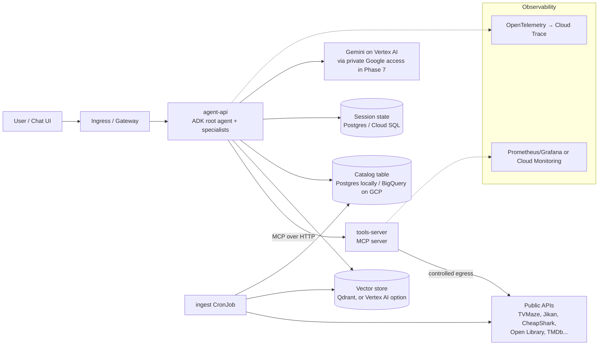

# Project Plan: "Watch Party" — an Entertainment Concierge Agent on Kubernetes and Google Cloud

A hands-on learning project for moving from cloud engineering into **Forward Deployed Engineer / AI Engineer / AI Infrastructure** work, aimed first at Google Cloud.

The agent answers questions like *"I've got 3 hours tonight, I liked Arcane, what should I watch or play?"* To do that it calls free public APIs (TV, anime, games, books, trivia) as tools, searches its own vector index for "something like X" questions, and queries a small structured catalog for "top-rated / filter by year" questions. It starts as a hand-written agent loop, gets rebuilt on Google's **Agent Development Kit (ADK)**, runs on Kubernetes locally, moves through GitOps, and finishes as a **private, locked-down agent platform on Google Cloud**.

> **What changed in this version (Oct 2026):** retargeted at the Google Cloud FDE / Customer Engineer postings. Gemini becomes the default model, ADK is added as the agent SDK right after the hand-written loop, multi-agent work and session state moved from "stretch" into the core path, a structured-data tool was added next to RAG, Phase 7 moves from Azure to GCP, and a light "FDE habits" track was added for the customer-facing half of the job. Phase 0 is unchanged.

---

## Target roles and the thesis of this project

**Primary target — Google Cloud (NYC):**

- **Forward Deployed Engineer III, Generative AI, Google Cloud** and **Partner FDE III, GenAI** — production agentic workflows (multi-agent systems, MCP servers), evaluation pipelines and observability, RAG over structured *and* unstructured data with vector databases, technical discovery with customers. Preferred: ADK / LangGraph / CrewAI, ReAct, self-reflection, hierarchical delegation, LLM-native metrics (tokens/sec, cost-per-request), state management, granular tracing.
- **AI Outcome Customer Engineer II, FDE** — integrating agents into a customer's IT estate: connectors, identity, data residency, compliance boundaries. Orchestration frameworks (LangGraph, AutoGen, CrewAI), enterprise integrations, code-level debugging.
- **Customer Engineer, Cloud AI (AI Natives)** and **Customer Engineer I, AI Infrastructure** — prototypes/PoCs/demos, agent orchestration or RAG, Kubernetes on Google Cloud, model benchmarks and cost-to-performance.
- Also NYC and worth watching: *Customer Engineer, Outcome, Financial Services* (your bank background is a direct fit) and *Agentic Data Cloud Customer Engineer II* (BigQuery + agents).

**Same skill set elsewhere:** Anthropic, OpenAI, Palantir and Microsoft FDE roles in NYC; AWS's new FDE org; NYC startups such as Hebbia, Ramp, Decagon, Databricks (FDE), Maybern, Edra; and AI-platform roles at banks (Capital One, JPMorgan, Morgan Stanley). The full list is in the appendix.

**The thesis:** the differentiator is not "I learned Kubernetes" or "I built a chatbot." It's **"I ship production agents into regulated enterprises — evaluated, observable, private, and secured."** The agent/RAG/eval half (Phases 1–4) is the new material; the private networking, identity and Terraform half (Phase 7) is what four years at a bank already gives you. Google's FDE posting literally lists "security perimeters" and "legacy data silos" as the job.

### How the phases map to what the Google postings ask for

| What the postings ask for | Where it's covered |
|---|---|
| Agentic workflows, tool calling, ReAct | Phase 1 |
| An agent framework (ADK / LangGraph / CrewAI) | Phase 1b, then everything after |
| MCP servers | Phase 3 |
| Multi-agent systems, hierarchical delegation, self-reflection | Phase 3b |
| RAG + vector DB over unstructured data | Phase 4 |
| Pipelines for **structured** data | Phase 4 (catalog table + SQL tool), Phase 7 (BigQuery) |
| Evaluation pipelines (accuracy, safety, latency) | Phases 1, 1b, 4, 5 |
| LLM-native metrics, granular tracing, state management | Phase 6 |
| Architecting AI systems on GCP | Phase 7 |
| Identity, security perimeters, data residency | Phases 6, 7 |
| Kubernetes on Google Cloud, benchmarks, accelerators | Phases 2–7, side exercise |
| Technical discovery, demos, reusable modules, product feedback | "FDE habits" (runs alongside every phase) |

---

## Scope discipline — read this before adding anything

The core path below is what grows the skill set. Everything else lives in **"Only if curious"** at the bottom and should be skipped by default.

**Core path:**

- **Phase 0** — ✅ done
- **Phase 1** — hand-written agent loop on Gemini. You're here. Keep it; it's how you learn what ADK hides. **📍 Steps 0–4 done (the ReAct loop works). Next: Step 5, the remaining tools. See the "Where we left off" note in the Phase 1 section.**
- **Phase 1b** — rebuild the same agent in ADK. Short, and it's the single biggest alignment fix for the Google roles.
- **Phases 2–4** — containerize, MCP + multi-agent, RAG + structured data. The real new material.
- **Phase 5 (trimmed)** — Argo CD and pull-based GitOps.
- **Phase 6 (trimmed)** — NetworkPolicies, sessions/state, LLM metrics and traces, guardrails, RBAC + quotas.
- **Phase 7** — the capstone on GCP. Private GKE, private access to Vertex AI, VPC Service Controls, Workload Identity, Secret Manager, controlled egress, all through Terraform — plus one comparison deploy to Google's managed agent runtime.

---

## FDE habits — the customer-facing half, done cheaply

Every Google FDE and CE posting asks for "technical discovery sessions with customers," reusable assets, and a feedback loop to product. You can't get customers from a side project, but you can produce the artifacts that prove you work that way. Each is short; do them as you go, not as a separate phase.

- **Discovery brief before each phase** (`docs/discovery/phase-N.md`, half a page): the "customer" problem, success metric, constraints, what's out of scope. Practising the questions is the point
- **Architecture one-pager** before Phase 3 and Phase 7 — the kind of thing you'd walk a customer's platform team through
- **A 5-minute recorded demo** at the end of Phases 1b, 4 and 7. CE roles are hired partly on demo skill
- **Field notes → feature requests** (`docs/field-notes.md`): every time ADK, MCP or a GCP service fights you, write what happened, the workaround, and the feature you'd ask product for. Turn the best one into a real GitHub issue or PR on the ADK repo. That is the "feedback loop to product" bullet, evidenced
- **Reusable module:** by Phase 7 the tools-server and the Terraform module should be clean enough that someone else could drop them into their own project. That's the "convert field patterns into reusable modules" bullet

---

## Why this domain works

- **No cloud resources needed early.** The data comes from free public APIs, so the agent is useful from day one.
- **Real tool-calling problems.** Each API has its own JSON shape and some have rate limits. Some will be down. Handling that is exactly what agent work looks like in practice.
- **A natural RAG use case.** Questions like "shows like X but darker" are semantic search over show and anime synopses.
- **A natural structured-data use case.** "Top-rated sci-fi shows since 2018 with more than 3 seasons" is a SQL question, not a vector question — which forces the "when do I use RAG vs a query" decision customers ask about.
- **Infrastructure you actually need.** Outbound egress to external APIs means you'll deal with DNS, NetworkPolicies, and retries for real reasons — and it sets up the private-egress story in Phase 7.
- **Easy to demo.** Anyone can ask it a question in an interview.

---

## End-state architecture



---

## API shortlist

These were picked from the public-apis README (Entertainment, Video, Anime, Games & Comics, and Books sections). Most need no key, which keeps the early phases simple.

| API | Use in the agent | Auth | Notes |
|---|---|---|---|
| **TVMaze** (`api.tvmaze.com`) | Search shows, episodes, schedules | None | Very reliable. Use this for your first tool |
| **Jikan** (`api.jikan.moe`) | Anime search, top anime, synopses | None | Rate limited, so it's a good lesson in backoff |
| **CheapShark** (`cheapshark.com/api`) | PC game deals and prices | None | Simple, clean JSON |
| **FreeToGame** (`freetogame.com/api`) | Free-to-play game catalog by genre/platform | None | Good for filter-style parameters |
| **Open Library** (`openlibrary.org`) | Book search, subjects | None | Good alternative domain for the RAG index |
| **Open Trivia DB** (`opentdb.com`) | Trivia questions | None | Fun "quiz me about X" tool |
| **JokeAPI** (`v2.jokeapi.dev`) | Jokes with category filters | None | Trivial. Good first MCP tool |
| **xkcd** (`xkcd.com/info.0.json`) | Comics | None | Trivial |
| **MusicBrainz** | Artist/album lookup | None | Requires a User-Agent header and about 1 request/sec. Good lesson in respecting API rules |
| **TMDb** | Movie data | Free API key | Add in Phase 3 to practice Kubernetes Secrets for a third-party key |

> Many entries in that list are dead, especially anything hosted on `herokuapp.com`, which lost its free tier. Before writing a tool, test the API with `curl`. Every tool should also return a clean error message the LLM can reason about ("service unavailable, try another source") instead of crashing.

---

## Tooling choices

| Concern | Choice | Why |
|---|---|---|
| Local cluster | **kind** | Disposable, cheap, standard in tutorials |
| Language | Python 3.12 + FastAPI | Already your strength. Python is also ADK's reference implementation |
| LLM | **Gemini** — Gemini API (AI Studio key) while learning, **Vertex AI** from Phase 7 | It's what the Google roles sell. Keep the Phase 1 client **OpenAI-compatible** so Gemini, Anthropic, Azure OpenAI or a self-hosted vLLM model are a base-URL swap |
| Agent framework | **Hand-written loop (Phase 1) → Google ADK (Phase 1b onward)** | The loop teaches what frameworks hide; ADK is named in every Google FDE posting and deploys to Cloud Run, GKE, or Google's managed agent runtime. LangGraph gets one comparison session in "Only if curious" |
| Tool protocol | MCP (Python MCP SDK, streamable HTTP), consumed through ADK's MCP toolset | Named explicitly in the Google FDE postings, and it gives you a second service to deploy |
| Embeddings | `fastembed` (local, free); Vertex AI embeddings in Phase 7 | No cost while learning |
| Vector DB | Qdrant (official Helm chart) | Simple, runs well in a cluster, cheap to keep on GKE. Vertex AI Vector Search / RAG Engine is a Phase 7 option |
| Structured data | Postgres in-cluster locally; **BigQuery** in Phase 7 | Covers the "structured and unstructured" requirement and maps to the Agentic Data Cloud roles |
| Evals | Your own script first, then **`adk eval`** with evalsets | Trajectory (which tools, in what order) plus answer quality |
| CI | GitHub Actions; Artifact Registry with keyless Workload Identity Federation in Phase 7 | Public portfolio. Same concepts as Azure DevOps |
| GitOps | Argo CD | Most common in job postings, and the UI helps while learning |
| Observability | kube-prometheus-stack + OpenTelemetry locally; Cloud Trace / Cloud Monitoring on GCP | Standard stack, and OTel is portable between them |
| Ingress | Plain Ingress (ingress-nginx) locally; GKE Gateway in Phase 7 | Don't take the Gateway API detour locally |

---

## Repo layout (monorepo)

```
watch-party/
├── apps/
│   ├── agent-loop/         # Phase 1: the hand-written loop (kept as a reference)
│   ├── agent-api/          # Phase 1b+: ADK agents, served over HTTP
│   ├── tools-server/       # MCP server wrapping public APIs
│   └── ingest/             # embedding + catalog ingestion job
├── charts/
│   ├── agent-api/
│   ├── tools-server/
│   └── ingest/
├── gitops/                 # what Argo CD watches (values per env, app-of-apps)
│   ├── apps/
│   └── envs/{local,gke}/
├── infra/                  # Phase 7: Terraform root module for private GKE on GCP
├── evals/                  # question set, expected tool calls, ADK evalsets
├── docs/
│   ├── decisions.md        # one paragraph per choice — interview prep
│   ├── discovery/          # FDE habit: a discovery brief per phase
│   ├── field-notes.md      # FDE habit: friction → feature requests
│   ├── benchmarks.md
│   ├── operational-readiness.md
│   └── runbooks/
├── kind-config.yaml
├── Makefile                # make up / make down / make deploy
└── README.md
```

---

## The phases

Each numbered step is sized for one work session. Check it off when you can show the "done when" result.

### Phase 0 — Kubernetes fundamentals (no AI yet) ✅ COMPLETE

**Goal:** be comfortable with the core objects before mixing in agent complexity.

- [x] Install Docker, kind, kubectl, helm, and k9s (k9s is optional but very helpful)
  - Docker 29.1.3, kind 0.31.0, kubectl v1.35.0, helm v4.0.4 were already installed. Installed k9s v0.51.0 via `brew install derailed/k9s/k9s`.
- [x] `kind create cluster --config kind-config.yaml`. Then delete it and recreate it to get used to the cluster being disposable
  - Created `kind-config.yaml` at repo root: single control-plane node, cluster name `watch-party`.
  - Gotcha: Docker Desktop must be running (the app, not just the CLI) before `kind create cluster` — first attempt failed with "Cannot connect to the Docker daemon ... Is the docker daemon running?" because the Desktop app wasn't open. Opened Docker Desktop, then the create succeeded.
  - `kubectl cluster-info` showed the API server and CoreDNS reachable at a `127.0.0.1:<random-port>` URL — kind runs the whole single-node cluster inside one Docker container and exposes that container's API server port to the host; this is written into `~/.kube/config` under context `kind-watch-party`, which is why bare `kubectl` commands work without `--context`. CoreDNS is the cluster's internal DNS, used later for service-to-service name resolution (Phase 3).
  - `kubectl get nodes` showed one `Ready` node `watch-party-control-plane`.
  - Deleted with `kind delete cluster --name watch-party`; confirmed gone when `kubectl get nodes` errored with "connection refused" on `localhost:8080` (kubeconfig had no valid current context left, falling back to the old default address). Recreated with the same `kind create cluster --config kind-config.yaml` and confirmed `Ready` node again.
- [x] Write a tiny FastAPI app with `/healthz` and `/hello`, then containerize it
  - Created `apps/hello/` with `main.py` (two routes: `/healthz` → `{"status":"ok"}`, `/hello` → greeting message), `requirements.txt` (`fastapi`, `uvicorn[standard]`), and a simple single-stage `Dockerfile` (`python:3.12-slim`, copies requirements first for layer caching, `CMD uvicorn main:app --host 0.0.0.0 --port 8000`). Multi-stage/non-root hardening deferred to Phase 2 per the plan.
  - Verified locally first with a venv (`uvicorn main:app --reload`, default bind `127.0.0.1:8000`) and `curl localhost:8000/healthz` / `/hello` — both returned correctly.
  - Built the image (`docker build -t hello:v1 .`) and ran it (`docker run -p 8080:8000 hello:v1`). Confirmed `curl localhost:8080/healthz` and `/hello` both work, while `curl localhost:8000/...` and `curl 0.0.0.0:8000/...` correctly fail — port 8000 only exists inside the container's own network namespace; `-p 8080:8000` is the one forwarding rule that tunnels traffic from the host's 8080 into the container's 8000, and that's the only path in.
  - Key lesson: `--host 0.0.0.0` in the Dockerfile CMD is required so uvicorn listens on all interfaces inside the container (not just the container's own loopback), which is what allows Docker's port mapping (and later, Kubernetes Services) to route traffic in at all. The uvicorn startup log (`Uvicorn running on http://0.0.0.0:8000`) only reports what the process bound to inside its own namespace — it says nothing about whether/how anything outside the container can reach it; that forwarding is a separate concern (Docker `-p`, or later a K8s Service) layered on top.
- [x] Load the image into kind (`kind load docker-image`) and deploy with **raw YAML**: Deployment, Service, ConfigMap (greeting text), Secret (fake key)
  - Created `apps/hello/k8s/{configmap,secret,deployment,service}.yaml`. ConfigMap holds `GREETING`; Secret (`stringData`) holds a fake `FAKE_API_KEY`; Deployment (1 replica, `image: hello:v1`, `imagePullPolicy: IfNotPresent`) injects both as env vars via `configMapKeyRef`/`secretKeyRef`; Service is `ClusterIP` mapping `port: 80` → `targetPort: 8000`.
  - `kind load docker-image hello:v1 --name watch-party` was required before `kubectl apply` — kind nodes run their own isolated container runtime and don't automatically see images built in Docker Desktop; without loading, the pod would fail to pull `hello:v1` (no registry configured).
  - `kubectl apply -f k8s/` created all 4 objects; `kubectl get pods` showed `1/1 Running`.
  - `ClusterIP` (the default Service type) only gives an address reachable *from inside* the cluster — `EXTERNAL-IP` was `<none>` by design, which is why `kubectl port-forward` was needed to reach it from the Mac at all for this bullet.
  - Verified env injection with `kubectl exec <pod> -- env | grep ...` (note: `-it` + piping to `grep` triggers a kubectl TTY-handling crash/panic — drop `-it` when not running an interactive shell).
  - `kubectl port-forward svc/hello 8080:80` logged `Forwarding from 127.0.0.1:8080 -> 8000` — port-forward resolves the Service's `targetPort` and connects straight to the pod, bypassing the Service's own `port: 80` proxy (that proxying only matters for in-cluster traffic).
  - Added a `/test_config` route reading `os.getenv('GREETING')` to prove the ConfigMap was actually wired through. Confirmed the local dev loop needed to pick up code changes with no registry/volume mount in play: rebuild image (`docker build`) → reload into kind (`kind load docker-image`) → `kubectl rollout restart deployment/hello` (needed because the image tag doesn't change, so Kubernetes has no other signal to replace the running pod) → re-run `port-forward` against the new pod. `curl localhost:1333/test_config` returned `{"message":"This is from the ConfigMap: Hello from the ConfigMap!"}`, confirming the full ConfigMap → Deployment → container → app chain.
- [x] Break it on purpose: a wrong image tag, a crashing app, a bad port. Debug with `kubectl describe`, `logs`, `get events`
  - **Wrong image tag:** set `image: hello:v10` (never built/loaded). Pod showed `STATUS ErrImagePull` → `ImagePullBackOff`. `kubectl describe pod` and `kubectl get events --sort-by=.lastTimestamp` both showed the root cause: kubelet tried `docker.io/library/hello:v10` and got `pull access denied, repository does not exist`, since no registry was configured and the tag was never loaded into kind.
  - Confirmed the Deployment → ReplicaSet → Pod ownership chain directly in the events (`deployment/hello` → `ScalingReplicaSet` → `replicaset/...` → `SuccessfulCreate` → `pod/...`). Also observed Kubernetes' rolling-update safety behavior: the old healthy pod was left running the whole time the new (broken) pod failed to pull, so the bad rollout never took down the working service.
  - **Crashing app:** added `sys.exit(1)` at the top of `main.py` to force an immediate startup crash, rebuilt/reloaded/restarted. Pod cycled `Running` → `Error` → `CrashLoopBackOff`, with `Restart Count` climbing and a `BackOff` event ("Back-off restarting failed container") showing Kubernetes' exponential restart-delay policy. `kubectl logs` came back **empty** — `sys.exit(1)` doesn't print anything, unlike an unhandled exception which would write a traceback to stderr before dying. Lesson: a bad exit code alone doesn't explain *why* without the app itself logging something first.
  - **Bad port:** changed the Deployment's `containerPort` from `8000` to `8080` (app still actually listens on 8000 per the Dockerfile `CMD`). Pod still came up `Running`/healthy, and `port-forward` + `curl` still worked — confirming `containerPort` is purely declarative metadata with no effect on actual traffic routing when the Service's `targetPort` references a port number directly. It would matter if a Service referenced a *named* port, or for NetworkPolicies/tooling that read it as the source of truth. Reverted `containerPort` back to `8000` afterward to keep the manifest accurate.
  - General takeaway: `kubectl describe pod` and `kubectl get events --sort-by=.lastTimestamp` show overlapping but differently-scoped information — `describe` is deep but scoped to one object (plus its recent events), `get events` is shallower per-item but spans the whole namespace/cluster chronologically, useful when you don't yet know which object is at fault.
- [x] Add liveness and readiness probes and resource requests/limits
  - Added `livenessProbe` and `readinessProbe` (both `httpGet` on `/healthz:8000`, `initialDelaySeconds: 3`, `periodSeconds: 5`) plus `resources` (requests `50m`/`64Mi`, limits `200m`/`128Mi`) to the container spec in `deployment.yaml`.
  - `describe` showed Kubernetes filling in probe defaults not specified: `timeout=1s #success=1 #failure=3` — so it takes 3 consecutive failures (~15s here) before a probe is considered failed, not one bad response.
  - Setting resources flipped the pod's `QoS Class` from `BestEffort` to `Burstable`. QoS is derived from what you set: `Guaranteed` (requests == limits everywhere), `Burstable` (requests set but below limits), `BestEffort` (nothing set). Under node memory pressure the kubelet evicts `BestEffort` first, then `Burstable`, `Guaranteed` last — so resources affect survivability, not just scheduling.
  - **Liveness vs readiness, demonstrated:** pointed only the readiness probe at a bogus path (`/not-real`) while leaving liveness on `/healthz`. Result: pod stayed `STATUS Running` with `RESTARTS 0` but `READY 0/1`, and `describe` logged `Warning Unhealthy ... Readiness probe failed: HTTP probe failed with statuscode: 404`. Readiness failure pulls a pod out of Service traffic; it never restarts the container. (Liveness failure is what triggers a restart.)
  - **Readiness gates rolling updates** — the most valuable practical takeaway. The rollout stalled with both pods alive: the old `1/1` pod was kept because the new one never became ready, so the broken version never took over and the Service kept serving. Same protective pattern as the bad-image-tag case.
  - Gotcha: `kubectl get endpointslices` default output lists *all* addresses in the `ENDPOINTS` column regardless of readiness, which is misleading. Readiness lives per-address in `conditions.ready`, only visible via `-o yaml`. Confirmed one endpoint `ready: true` (old pod) and one `ready: false` (new pod) during the broken rollout.
  - Tested Service routing from inside the cluster with a throwaway pod: `kubectl run curl-test --rm -i --image=curlimages/curl --restart=Never -- curl -s http://hello/healthz` (hits the Service's `port: 80` by DNS name, exercising real CoreDNS + Service routing rather than bypassing it like `port-forward` does).
  - Forced the Service fully dark by deleting the old ReplicaSet (`kubectl delete rs <old>`) — the Deployment controller keeps old ReplicaSets for rollback history but does not recreate a deleted one, so the last ready pod went away. The in-cluster curl then showed `Host hello:80 was resolved. IPv4: 10.96.234.155 ... Connection refused` — DNS resolves and the ClusterIP exists, but with zero ready endpoints kube-proxy refuses immediately rather than timing out. Useful symptom to recognize. (Deleting old ReplicaSets discards rollback history — fine for a throwaway app, not a casual production move.)
  - Reverted the readiness path to `/healthz`; back to a single `1/1 Running` pod with one `ready: true, serving: true` endpoint.
- [x] Convert the YAML into a Helm chart with `values.yaml`. Deploy with `helm install`, change a value, then `helm upgrade` and `helm rollback`
  - Built `charts/hello/` with `Chart.yaml`, `values.yaml`, and `templates/{deployment,service,configmap,secret}.yaml`. Everything previously hardcoded (replica count, image repo/tag/pullPolicy, service ports, greeting, fake key, resources) became a value. `Chart.yaml`'s `version` (chart version) and `appVersion` (app version) are deliberately independent.
  - Templating notes: `.Values` reads `values.yaml`; `.Release.Name` comes from `helm install <name>` and is used in object names so the chart can be installed more than once without collisions; `.Chart.Name` comes from `Chart.yaml`. `| quote` prevents YAML from coercing string values like `yes`/`1.0` into bools/floats. `{{- toYaml .Values.resources | nindent 12 }}` serializes a whole nested map and indents it to land correctly, letting users override the entire block without the template knowing its shape.
  - Helm refuses to adopt resources it didn't create, so the raw-YAML objects had to be removed first (`kubectl delete -f apps/hello/k8s/`) or `helm install` fails with an ownership-metadata error.
  - Used `helm lint` and `helm template hello ./charts/hello` to render locally and eyeball the output (especially indentation) before touching the cluster. Then `helm install hello ./charts/hello` → `REVISION: 1`, pod `1/1 Running`.
  - **Stale ConfigMap gotcha:** changing `config.greeting` and running `helm upgrade` updated the ConfigMap object but the app still served the old value. A Deployment only rolls pods when its *pod template* changes; a ConfigMap is a separate object, so the template was byte-identical and the controller correctly did nothing — and the running container had its env injected once at startup. Fixed properly with the standard checksum-annotation idiom on `spec.template.metadata.annotations`: `checksum/config: {{ include (print $.Template.BasePath "/configmap.yaml") . | sha256sum }}`. The annotation is functionally inert; it exists so a ConfigMap content change produces a different pod template and therefore a real rollout. (`kubectl rollout restart` is the manual equivalent.)
  - **Rollback semantics:** `helm rollback hello 1` did not reset the revision counter to 1 — it appended a *new* revision 4 described as `Rollback to 1`. Helm's history is append-only, same philosophy as `git revert` vs `git reset`. A revision is a snapshot of the complete rendered manifest set, not a diff, so rolling back reverted the greeting *and* removed the checksum annotation together.
  - Neat detail: the rolled-back pod reused the original ReplicaSet (`hello-6594fb5757-...`) because Kubernetes names ReplicaSets by hashing the pod template, and the restored template was identical to revision 1's. Helm's revision history and the Deployment's ReplicaSet history are independent systems that happened to line up.
  - Also set up VS Code for chart editing: `ms-kubernetes-tools.vscode-kubernetes-tools` (registers a `helm` language mode that tolerates Go templating inside `.yaml`) plus a `"files.associations": {"**/templates/*.yaml": "helm"}` setting; optionally `tim-koehler.helm-intellisense` for `.Values.*` autocomplete.

**Concepts:** pods, deployments, ReplicaSets, services, labels/selectors, probes, ConfigMaps vs Secrets, Helm templating.
**Done when:** `helm install hello ./charts/hello` works and `kubectl port-forward` reaches it. ✅ Verified — `helm install hello ./charts/hello` deployed cleanly and `kubectl port-forward svc/hello 8080:80` + `curl localhost:8080/hello` returned the app's response.

---

### Phase 1 — Agent v1, hand-written loop in plain Python *(you are here)*

**Goal:** understand tool calling from first principles. No Kubernetes and no framework in this phase.

> **Why not jump straight to ADK?** The Google postings ask for experience with frameworks *and* for debugging state-management and integration problems inside them. You can only debug what a framework hides if you've written the loop once yourself. This phase is a few sessions, not weeks — then Phase 1b moves you onto ADK.

> **📍 WHERE WE LEFT OFF (2026-10-20): Step 4 (the ReAct loop) works on every exit path. Next is Step 5.**
> Working from the coaching plan's steps 0–9 (0 = discovery + hygiene, 1 = LLM client, 2 = first tool, 3 = manual round-trip, 4 = loop, 5 = remaining tools, 6 = metrics, 7 = CLI, 8 = evals, 9 = decisions). **Steps 0–4 are done.** Step 3 was committed (`5b44e17`); its two experiments are logged in `docs/field-notes.md` (2026-10-18 entry). Next session:
> 1. **Two small leftovers in `loop.py` (committed in `2ac16c8` with usage moved above the guard, `ensure_ascii=False`, and `-> dict` done):** add a `[tool] name(args) -> result[:200]` print inside the inner `for`, and drop the now-redundant `isinstance(tool_result, dict)` check in the `tool_calls` record.
> 2. **Two open questions to answer out loud:** should the loop or the CLI (Step 7) turn `answer=None` into a user-facing message? What happens if a message has neither `content` nor `tool_calls`?
> 3. **Step 5:** `find_game_deals` (CheapShark) and `search_books` (Open Library) in `tools.py`, following the required layout (function → schema → two registry lines). `curl` each API first, trim the response, and add a smoke test per tool to `__main__`. Try a vague vs a precise schema description and watch tool selection change. Then Step 6 (metrics), and so on.

- [x] Build an LLM client wrapper. One class with `chat(messages, tools)`. **Speak the OpenAI-compatible chat-completions API** and point it at **Gemini** by default (the Gemini API offers an OpenAI-compatible endpoint, so it's a base URL and a key). Azure OpenAI, Anthropic (via a thin adapter) and self-hosted vLLM sit behind the same interface. Verify the current endpoint and model names in Google's docs when you start
  - `apps/agent-loop/agent/llm.py`: `LLMClient(model, base_url, api_key, reasoning_effort)` where each argument falls back to an env var (`MODEL`, `BASE_URL`, `GEMINI_API_KEY`, `REASONING_EFFORT`). `chat(messages, tools=None)` returns a `ChatResult(response, latency_s)` dataclass holding the **full** `ChatCompletion` (the loop needs `.choices`, metrics needs `.usage`), not just the text.
  - Endpoint: `https://generativelanguage.googleapis.com/v1beta/openai/` (Google's OpenAI-compatibility layer, called with the `openai` Python SDK). Model: `gemini-3.8-flash`, pinned rather than a `-latest` alias, so eval results can't change because the model was swapped underneath. Google's native `google-genai` SDK was considered and rejected for Phase 1 because it only works with Gemini. The compatible endpoint keeps it a base-URL swap to Ollama/vLLM/Azure. (ADK uses the native SDK internally, which is a Phase 1b comparison point.)
  - Design choices: **fail fast** in `__init__` if required config is missing, rather than a confusing 400 three calls later. One `OpenAI` client created per instance and kept on `self._client` (connection pool). `time.perf_counter()` for latency (monotonic; `time.time()` can jump with NTP). `load_dotenv()` lives only in `if __name__ == "__main__":` because library code shouldn't read files when it's imported.
  - **Optional request arguments are built as a `kwargs` dict.** `tools` and `reasoning_effort` are added only when set (`if tools:` is false for both `None` and `[]`; some providers reject an empty tools list), then `create(**kwargs)`. A first draft accepted `tools` but never passed it on. That's a silent bug: no error, the model just never sees the tools.
  - Gotchas: `load_dotenv()` returns a **bool** (whether it found a file), not a dict. Values go into `os.environ`, so read them with `os.getenv()`. That's also what makes Phase 2 work unchanged when env vars come from a ConfigMap/Secret instead of a file. `git check-ignore -v` matches *patterns*, so it "succeeds" even for a file that doesn't exist (the key had been put in `.env.example` by mistake). A `400 Please pass a valid API key` meant a badly copied key (55 characters instead of 39), not a permissions problem; a permissions problem would usually be a 403. Debug order: test the key with `curl` first to separate "bad key" from "bad code". `load_dotenv()` doesn't override variables already exported in the shell.
  - Usage findings (details in `docs/field-notes.md`): Gemini 3.x **thinking tokens are hidden** in `usage`, so `total_tokens > prompt + completion` and `completion_tokens_details` is `None`. One run had 751 hidden tokens, about 50% of the bill. `reasoning_effort=low` cut a trivial call to `13 + 7 = 20` tokens, 0.68 s, but it's a hint, not a cap: the same prompt gave 357 hidden tokens on one run and 0 on the next, with 2.2× the latency. **One run proves nothing about cost or latency.** Use percentiles over N runs.
  - `scripts/list_models.py`-style listing: `client.models.list()` returns a page you can iterate over, and IDs come back prefixed with `models/`. Model choice: filter to text chat models → prefer pinned over `-preview`/`-latest` → compare Flash vs Flash-Lite price and rate limits → **decide with evals in Step 8**, not by guessing.
- [ ] Write 3 tools as plain Python functions with JSON schemas: `search_tv_shows` (TVMaze), `find_game_deals` (CheapShark), `search_books` (Open Library)
  - **`search_tv_shows` ✅ done** in `apps/agent-loop/agent/tools.py`. `find_game_deals` and `search_books` are next, in Step 5. Run `curl` on each API first.
  - **A tool has three parts:** the **function** (Python; does the work), the **schema** (JSON; *all the model ever sees*), and the **registry** (lets the loop find the function the model asked for). The model never runs code. It only asks for a tool by name with JSON arguments, and our code runs it.
  - **Required `tools.py` layout, which every new tool follows:**
    ```
    constants (URL, MAX_RESULTS, TIMEOUT_S...) + private helpers (_strip_html)
    def tool_function(...) -> dict          # never raises
    TOOL_FUNCTION_SCHEMA = {...}            # directly below the function it describes
    ... (next tool + its schema) ...
    # ── Registry ──  (always at the bottom)
    TOOLS = {"tool_name": tool_function}    # name → the FUNCTION itself (no parentheses)
    TOOL_SCHEMAS = [TOOL_FUNCTION_SCHEMA]   # list of schemas → client.chat(..., tools=TOOL_SCHEMAS)
    ```
    The schema's `"name"` **must exactly match** its `TOOLS` key, because the loop does `TOOLS[tool_call.function.name](**args)`. Bugs already hit: `TOOLS` pointing to the *schema* instead of the function (`TypeError: 'dict' object is not callable` once the loop calls it), and `TOOL_SCHEMA` vs `TOOL_SCHEMAS` naming (would cause an `ImportError`). No parentheses in `TOOLS`: `search_tv_shows()` would *call* the function when the module is imported. Adding a tool should only mean adding the function, its schema and two registry lines. The loop never changes.
  - **Writing schema descriptions:** the description is the only thing the model uses to decide *when* to call a tool and *what arguments* to send, so treat it as documentation for the model. A good one has: **(1)** what it does and where the data comes from, first sentence first; **(2)** known quirks seen in real output (TVMaze matching is *fuzzy*: "arcane" also returned "Cane" and "Magical☆Shopping Arcade", so tell the model to check names); **(3)** the exact fields returned, so the model knows which questions it can answer ("is it on Netflix?" → `where_to_watch`); note nullable fields (`rating` may be null); use an f-string with `MAX_RESULTS` so the number stays in sync; **(4)** "Use this when…" guidance; **(5)** "Do NOT use it for…" guidance (no genre/mood/"shows like X" searches; it matches titles only, and that's the Phase 1 scope boundary from the discovery brief); **(6)** parameter descriptions with **concrete examples** ("e.g. 'Arcane' or 'Breaking Bad'. Not a genre, mood, or description"), which are the most reliable way to shape the arguments. The first draft ("searches by keyword and returns basic information") was correct but gave the model nothing to decide with. In Step 5, compare a vague and a precise description and watch tool selection change.
  - **Tool error contract:** a tool **never raises**. Every failure becomes `{"error": "<short, model-readable message with a next step>"}`. A raised exception would crash the loop; an error dict lets the model reason and fall back ("TVMaze is down, but here's a game…"). `except` order matters: `httpx.TimeoutException` is a *subclass* of `httpx.RequestError`, so it must come first. `raise_for_status()` turns 4xx/5xx into one `HTTPStatusError` path. `resp.json()` gets its own `try/except ValueError` (a 200 response with an HTML maintenance page would otherwise raise). `(show.get("rating") or {}).get("average")` handles a key that's missing *or* explicitly `null`. `"count"` makes empty results clear so the model says "not found" instead of making something up. The Step 4 loop adds a second layer: wrap every tool call in a `try/except` as a safety net for bugs in any tool.
  - Correction noted: `httpx` *does* have a default timeout (5 s); `requests` doesn't. We set `TIMEOUT_S` explicitly anyway, to document it and be able to tune it.
  - Testing without editing the file: `python -c "import tools; tools.TVMAZE_SEARCH_URL = 'https://api.tvmaze.invalid/...'; print(tools.search_tv_shows('arcane'))"` → `{'error': 'TVMaze is unreachable (ConnectError).'}`. (`.invalid` is a reserved TLD that never resolves.)
- [x] Hand-write the agent loop: send a message, run any tool calls the LLM requests, feed the results back, and repeat until a final answer or `max_steps`. This is the **ReAct** pattern (reason → act → observe); name it in your notes, because the posting does
  - **Step 3, manual round-trip ✅ (2026-10-18, committed `5b44e17`).** Run with `cd apps/agent-loop/agent && python loop.py`. The round-trip code lives in `loop.py`'s `__main__`, not `llm.py`: the client must not import the tools, because it's the provider-agnostic layer, and a top-level import there would load the TV tools for anything that imports `llm`. `loop.py` is the file that connects the LLM to the tools.
  - **The message sequence:** `system` → `user` → *call 1* → `assistant` (`tool_calls`, `content=None`, `finish_reason="tool_calls"`) → `tool` (`tool_call_id` = the call's `id`, `content` = `json.dumps(result, ensure_ascii=False)`) → *call 2* → text answer with `finish_reason="stop"`. The model is stateless, so `messages` is its only memory. The assistant tool-call message has to come before the tool result, both for that reason and because the API validates the order.
  - **Gotchas:** `arguments` is a JSON **string**, so use `json.loads` before `fn(**args)` (the same dict-unpacking as `create(**kwargs)` in `llm.py`). On a tool-call turn the `thought_signature` sits on **each tool call**, not on the message. Append with `msg.model_dump(exclude_none=True)` so it survives. Python namespaces: an import in `llm.py` (e.g. `load_dotenv`) isn't visible in `loop.py`; each file imports what it uses from where it's defined. Importing a module doesn't run its `if __name__ == "__main__":` block. Readable output: `choice.model_dump_json(indent=2, exclude_none=True)`, since SDK objects are Pydantic models.
  - **Lesson:** the final answer mixed tool data (finished, Netflix) with an ungrounded claim from training data ("other series in development"). Check answers against the tool output, which is a Step 8 eval concern. Q&A on message ordering and `tool_call_id` is in `docs/field-notes.md` (2026-10-18).
  - **Step 3 experiments (2026-10-20):** the Gemini compat layer translates OpenAI messages into a native `GenerateContentRequest` and resolves each tool result's function **name** by matching `tool_call_id` against the preceding assistant `tool_calls`. A missing assistant message *and* a fake id (`"call_000"`) both fail with the same indirect 400, `function_response.name: Name cannot be empty` (only the `contents[N]` index differs). Dropping `extra_content` fails with an explicit `Function call is missing a thought_signature`. Lesson: append the assistant message **as returned**, never rebuild it. That matters again when sessions are persisted in Phase 6.
  - **Step 4, the loop ✅ (2026-10-20).** `run_agent(client, user_message, max_steps=6) -> AgentResult` in `loop.py`. `AgentResult` holds `answer`, `stop_reason`, `steps`, prompt/completion/total tokens, summed `llm_latency_s`, a `tool_calls` trajectory (`name`, raw `args`, `error` flag) and the full `messages` transcript. It's the contract for Steps 6–8.
    - **Loop shape:** call the LLM → count latency/usage for *every* call → guard: `msg is None` → return with the raw `finish_reason` → append the assistant message (`model_dump(exclude_none=True)`) → if `msg.tool_calls`: run **each**, append one `role: "tool"` message per call with its `tool_call_id` → loop; else set `answer`/`stop_reason` and return. Falling out of the `for` means `stop_reason="max_steps"` (the dataclass default). It branches on `msg.tool_calls`, not `finish_reason`, because "are there tools to run?" is what the loop needs, and providers aren't consistent about `finish_reason`.
    - **`_run_tool_call` never raises:** a separate guarded step each for `json.loads` (bad JSON), `isinstance(args, dict)` (e.g. `"Arcane"` sent as the arguments), `TOOLS[name]` (unknown tool; the error lists the valid names), `inspect.signature(fn).bind(**args)` (wrong parameter names, checked *before* running so a `TypeError` inside the tool isn't misreported as bad arguments), then `fn(**args)` under `except Exception`, which sends only `type(e).__name__` to the model and prints the full `repr` locally (raw exception text can carry URLs, and later API keys). Every error message ends with a next step for the model. All five branches tested without the LLM by faking `tool_call` with `SimpleNamespace`.
    - **Bugs hit while building it:** an editor auto-import gave `from importlib.metadata.diagnose import inspect` (a function, not the module) → `AttributeError: 'function' object has no attribute 'signature'`. Wrapping the whole `msg` in `{"role": "assistant", "content": msg}` → Gemini 400 `Expected string or list of content parts`; `json.dumps(msg)` → `ChatCompletionMessage is not JSON serializable`. You never build the assistant message, you only pass it back. A first `if msg:` guard turned a crash into **six identical retries** and hid their latency. A no-message response has to be terminal.
    - **Smoke tests in `__main__`, one per exit path:** happy path (`stop`, 2 steps); `max_steps=1` (`answer=None`, `max_steps`, tool ran but its result was never seen); two shows in one question (`stop`, 2 steps, **2 parallel tool calls in one turn**); unknown title "The Zorblax Saga" (`stop`, grounded "couldn't find it" from `count: 0`); "The Glorbnax Chronicles" (blocked on call 1: `message=None`, `finish_reason="content_filter: PROHIBITED_CONTENT"`, a false positive specific to that word; note the non-standard prefixed string). Details in `docs/field-notes.md` (2026-10-20).
    - **Grounding is still the open problem:** "creators always intended two seasons" (Arcane, every run) and a stale "Season 2 in January 2025" (Severance) aren't in any tool output. The system prompt's "don't guess" isn't enough. Step 8 needs a groundedness check; try today's date in the system prompt.
  - ⏭️ **Next up:** Step 4 cleanup + commit, then Step 5 (see "Where we left off").
- [ ] Trim API responses before returning them to the LLM, keeping only the fields it needs. This is a big lesson in token cost
  - TVMaze done: **11,597 → 2,077 characters (~2,899 → ~519 tokens, −82%)** per call for "arcane". Kept: name, type, genres, status, premiered/ended, `avg_runtime_min` (what "3 hours tonight" needs), rating, `where_to_watch` (`webChannel` → `network` fallback, since streaming shows use `webChannel`), summary (HTML stripped, 300 characters). Dropped IDs, URLs, `_links`, `externals`, images, `weight`, `schedule`. Top 5 results only. That saves ~2,380 tokens per call, ≈ 71k tokens per eval run (10 questions × ~3 calls). Also, use `json.dumps(..., ensure_ascii=False)` when sending results to the model (`—` instead of `—`). Repeat the trimming for CheapShark and Open Library in Step 5.
- [ ] Log every step: the tool name, arguments, latency, input/output tokens, and **cost**. Compute tokens/sec and cost-per-request from day one — these are the exact "LLM-native metrics" in the Google posting
  - Prerequisite found in Step 1: cost has to include hidden thinking tokens (`total − prompt − completion`, billed at the output rate). Look up Flash/Flash-Lite pricing per 1M tokens on Google's pricing page and keep it in config.
- [ ] Create `evals/questions.yaml` with 10 questions and the tool(s) you expect each to use. Write a small script that runs them and reports pass/fail on the **trajectory** (right tools, right order) and on the answer
  - Pass target from the discovery brief: ≥ 80% (8 of 10). Use it to compare Flash vs Flash-Lite and `reasoning_effort` low vs default. Use several runs per question because results are non-deterministic.
- [ ] *FDE habit:* write `docs/discovery/phase-1.md` before you start, and `docs/decisions.md` → "why hand-write the loop first"
  - `docs/discovery/phase-1.md` ✅ written. Targets: ≥ 80% eval pass rate and ≤ $0.10 per request (likely far too generous, so check it against real Step 6 costs). Semantic "find something similar" search is explicitly out of scope until Phase 4. `docs/decisions.md` is still empty (Step 9).
  - `docs/field-notes.md` started (three entries): the `thought_signature` coming through the OpenAI-compatible API, hidden thinking tokens in `usage`, and non-deterministic thinking even at `reasoning_effort=low`.
  - Repo hygiene: `.gitignore` covers `.env`, `*secret*.yaml`, `__pycache__/`. The real key is in `apps/agent-loop/.env` (ignored). `apps/agent-loop/.env.example` lists the variable names only and *is* committed.

**Concepts:** tool schemas, the ReAct loop, context management, failure handling, token/cost accounting, trajectory evals.
**Done when:** `python -m agent "find me a cheap co-op game and a show to watch after"` uses 2 tools correctly on Gemini, the log shows tokens and cost per request, and the eval script runs.

### Phase 1b — Rebuild the same agent on Google ADK

**Goal:** move onto the agent SDK the Google roles name, and see exactly what it does for you compared to your own loop.

- [ ] Port the three tools into an ADK `Agent` (ADK builds the tool schema from type hints and docstrings — compare that to your hand-written JSON schemas)
- [ ] Run it with `adk web` and `adk run`. Step through the dev UI's event/trace view and map each event to a step in your Phase 1 loop
- [ ] Look at how ADK represents **sessions, state and events**. Write one paragraph on where your hand-written loop kept state vs where ADK keeps it — this is the "state management" the posting keeps mentioning
- [ ] Convert `evals/questions.yaml` into an ADK evalset and run `adk eval`. Keep your own script too, and note what each catches that the other doesn't
- [ ] Keep `apps/agent-loop/` as a reference. From here on, `agent-api` is the ADK version
- [ ] *FDE habit:* 5-minute recorded demo of both versions side by side, and the first entries in `docs/field-notes.md`

**Concepts:** agent frameworks, tool declaration, runners, sessions/state/events, built-in evaluation.
**Done when:** the ADK agent passes the same eval set as the Phase 1 loop, and `docs/decisions.md` has a "hand-written loop vs ADK" entry you could talk through in an interview.

### Phase 2 — Containerize the agent and run it in the cluster

**Goal:** your ADK agent is a real Kubernetes workload.

- [ ] Serve the ADK agent over HTTP (ADK's FastAPI app, or your own FastAPI wrapper with `POST /chat` and `GET /healthz`)
- [ ] Use a multi-stage Dockerfile with a slim base image, running as non-root
- [ ] Write the Helm chart: Deployment, Service, a ConfigMap for the model name and max steps, and a Secret for the Gemini API key, created with `kubectl create secret` and **never committed**
- [ ] Deploy to kind and call it via port-forward
- [ ] Scale to 3 replicas and watch requests spread across them in the logs. Notice what happens to conversation state when two turns hit different replicas — that's the problem Phase 6 solves

**Concepts:** 12-factor config, secret handling, stateless services, scaling, why session state can't live in the pod.
**Done when:** `curl localhost:8080/chat -d '{"message":"..."}'` returns an answer from inside the cluster.

### Phase 3 — Split tools into an MCP server (microservices + cluster DNS)

**Goal:** two services that talk over the cluster network, plus a real agent protocol.

- [ ] Move the tools into `tools-server` as an MCP server using the Python MCP SDK over streamable HTTP
- [ ] Add more tools: Jikan anime, FreeToGame, Open Trivia, JokeAPI
- [ ] Add TMDb with a free API key. It goes in a second Secret that only `tools-server` mounts, which is least-privilege at the pod level
- [ ] Have `agent-api` discover tools from the MCP server at startup through ADK's MCP toolset, reached at `http://tools-server.watch-party.svc.cluster.local`
- [ ] Debug DNS deliberately: `kubectl run -it debug --image=busybox -- nslookup tools-server`. Then look at how CoreDNS resolves both internal names and external ones like `api.tvmaze.com`
- [ ] Add timeouts, retries with backoff, and clean error messages to every tool
- [ ] *FDE habit:* the architecture one-pager for the two-service design

**Concepts:** service discovery, cluster DNS, MCP, separation of concerns, per-service secrets.
**Done when:** you can add a new tool by changing only `tools-server`, and the agent picks it up after a redeploy.

### Phase 3b — Multi-agent: delegation and self-reflection *(moved in from "stretch")*

**Goal:** cover the "multi-agent systems, ReAct, self-reflection, hierarchical delegation" line from the Google FDE postings with something real.

- [ ] Split the single agent into a **root router agent** plus specialists: `tv_agent`, `games_agent`, `books_agent`. Each specialist only sees its own tools. This is hierarchical delegation
- [ ] Add a **critic / self-reflection step**: before the final answer goes out, a reviewer agent checks it against the user's constraints ("3 hours", "co-op", "not horror") and sends it back once if it fails. Use one of ADK's workflow agents (sequential or loop) for this
- [ ] Extend the evals with 5 multi-domain questions ("a show and a game for tonight") and check the router delegates correctly
- [ ] Compare cost and latency single-agent vs multi-agent on the same eval set. Write the result in `docs/decisions.md` — "multi-agent isn't free" is an answer interviewers like
- [ ] Optional, one session: expose one specialist over **A2A** (Agent2Agent) as its own service and have the router call it remotely. Skip if Phase 3b is already taking long

**Concepts:** routing, delegation, reflection loops, workflow agents, the cost of extra LLM calls.
**Done when:** a multi-domain question is routed to two specialists, the critic catches at least one bad answer in the eval set, and you have the single- vs multi-agent numbers.

### Phase 4 — RAG + structured data: "something like X" and "top-rated since 2018"

**Goal:** handle questions keyword APIs can't answer, over both unstructured text and a structured table.

- [ ] Install Qdrant via its Helm chart. Look at the StatefulSet and PersistentVolumeClaim it creates
- [ ] Install a small Postgres (Helm chart) for the structured catalog
- [ ] Write an `ingest` job that pulls a few thousand TVMaze shows (paginated `/shows` endpoint), top anime from Jikan, and a few Open Library subjects. It cleans and chunks the synopses, embeds them with `fastembed`, and upserts them with metadata (genre, year, rating, source) into Qdrant. **The same job writes the structured fields** (title, type, year, rating, genres, seasons/episodes, runtime) into a Postgres `catalog` table
- [ ] Run it first as a Kubernetes **Job**, then as a weekly **CronJob**. Make it idempotent so re-runs don't duplicate rows
- [ ] Add a `semantic_search` tool with metadata filters, e.g. `type=anime`, `year>2015`
- [ ] Add a `query_catalog` tool for structured questions. Start with a parameterized query tool (filters as arguments, read-only DB user), not free-form text-to-SQL — and write down why
- [ ] Extend the evals with 5 "similar to X" questions and 5 structured questions. Check the agent picks the right tool for each type, and add a groundedness check (did the answer only use retrieved results?)
- [ ] Delete the Qdrant and Postgres pods and confirm the data survives through the PVCs
- [ ] *FDE habit:* recorded demo; `docs/decisions.md` → "RAG vs structured query: how the agent decides"

**Concepts:** embeddings, chunking, metadata filtering, structured vs unstructured retrieval, safe database tools, hybrid answers (RAG + SQL + live APIs), StatefulSets, PVCs, Jobs/CronJobs.
**Done when:** "anime like Cowboy Bebop but newer" comes from the vector index, "highest-rated sci-fi shows since 2018" comes from the catalog table, and both are in the eval set.

### Phase 5 — GitOps with Argo CD (trimmed)

**Goal:** stop running `helm install` by hand. Git becomes the source of truth.

> **Trim note:** CI itself is already familiar territory from Azure DevOps. Build the pipeline, but don't sink sessions into GitHub Actions syntax. The genuinely new idea here is **pull-based deployment** — a controller inside the cluster reconciling against Git, rather than a pipeline pushing changes in. That's the part to understand deeply.

- [ ] GitHub Actions on push: lint, unit tests, build images, push to GHCR tagged with the commit SHA. Keep it simple
- [ ] Install Argo CD in kind. Create an app-of-apps in `gitops/` that deploys all three charts plus Qdrant and Postgres
- [ ] Have CI open a commit (or PR) that bumps the image tag in `gitops/envs/local/`. Argo CD then syncs the change
- [ ] Add the eval run (your script and/or `adk eval`) as a CI step that fails the build if pass rate drops below a threshold
- [ ] Practice drift: `kubectl edit` a deployment by hand and watch Argo revert it
- [ ] Practice rollback by reverting the Git commit
- [ ] Write the "why GitOps" paragraph in `docs/decisions.md` — how pull-based reconciliation differs from the push model you already use, and what that buys you in a regulated environment (no cluster credentials in the pipeline, Git as the audit trail)

**Concepts:** push vs pull deployment, declarative state, drift detection, evals as a quality gate.
**Done when:** a merged PR changes what's running in the cluster without you touching kubectl.

### Phase 6 — State, security, observability and guardrails (trimmed)

**Goal:** the production layer — the "state-management issues", "granular tracing" and "LLM-native metrics" from the Google FDE postings, plus the platform controls the bank roles want.

**In scope — do these five:**

- [ ] **Session state:** move ADK sessions from in-memory to a persistent session store backed by the Postgres you already run (ADK has a database-backed session service). Re-run the Phase 2 three-replica test and confirm a conversation survives turns landing on different pods and a pod restart. Add one piece of long-lived memory ("I don't like horror") and decide what belongs in session state vs user memory
- [ ] **NetworkPolicies:** recreate the kind cluster with Calico, since kind's default networking doesn't enforce policies. Then set default-deny, and allow agent → tools-server, agent → Qdrant/Postgres, and tools-server → internet egress on 443 plus DNS on 53. Verify that agent-api *cannot* reach the internet directly. This is the local rehearsal for Phase 7's egress story
- [ ] **RBAC and quotas:** give each workload its own ServiceAccount with least privilege. Add a `ResourceQuota` and `LimitRange` per namespace, and prove it by trying to deploy something that exceeds the quota
- [ ] **LLM metrics and traces:** install kube-prometheus-stack and expose custom metrics — tool calls per API, error rate, input/output tokens, **tokens/sec**, **cost per request**, and latency per agent. Add OpenTelemetry so one trace shows the whole chain (user request → router → specialist → LLM call → MCP tool → external API). Make the token/cost panel real — that's what distinguishes LLM observability from ordinary APM
- [ ] **Guardrails:** limit max steps and max tokens per request, validate tool inputs, and add a basic prompt-injection check, since API data is untrusted text going into the prompt. Add safety cases to the eval set so "safety" is measured, not just claimed

**Also, cheap and worth it:**

- [ ] Write `docs/operational-readiness.md` — a short checklist the agent has to pass before it's considered live (probes defined, resource limits set, dashboard exists, alert exists, runbook exists, secrets not in Git, rollback path tested, eval gate green)
- [ ] Write two runbooks in `docs/runbooks/` — e.g. "tools-server is returning 5xx" and "eval pass rate dropped after a deploy". Short, numbered, with the actual commands

**Explicitly out of scope here:** Gateway API, cert-manager, Redis caching, HPA and load testing. See "Only if curious".

**Concepts:** session state and memory, zero-trust networking, egress control, multi-tenancy, LLM observability and cost visibility, AI security basics, operational readiness.
**Done when:** a conversation survives a pod restart; a Grafana dashboard shows requests, tool usage, tokens/sec and cost per request; one trace spans router → specialist → tool → external API; a NetworkPolicy test proves agent-api can't reach the internet directly; and the readiness checklist is honestly passable.

### Phase 7 — The capstone: a private agent platform on Google Cloud

**Goal:** this is the differentiator. Phases 1–6 teach things you don't have yet; **this phase is where four years of cloud, Terraform and private-network engineering show up on the platform Google is hiring for.**

Most agent portfolios deploy to a public endpoint and stop. The FDE posting describes the real job as wiring AI into customers' APIs, data silos and **security perimeters**; the AI Outcome CE posting adds identity, data residency and compliance boundaries. That's your day job — just on Azure. This phase proves you can do it on GCP.

**The pitch this phase earns:** *"I ship production agents into regulated environments on Google Cloud."*

> **Azure → GCP translation table** (write this into `docs/decisions.md` as you go — being able to say "this is the GCP equivalent of X" is valuable in a Google interview *and* with customers migrating from Azure):
> VNet → VPC · AKS → GKE · ACR → Artifact Registry · Key Vault + CSI → Secret Manager (+ CSI / GKE add-on) · AKS Workload Identity → Workload Identity Federation for GKE · Private Endpoint → Private Service Connect / Private Google Access · Private DNS zones → Cloud DNS private zones · NAT Gateway / Azure Firewall → Cloud NAT + Cloud NGFW / Secure Web Proxy · Azure Policy → Org Policy · (no direct Azure equivalent) → VPC Service Controls · Azure OpenAI → Vertex AI (Gemini) · Azure AI Search → Vertex AI Vector Search / RAG Engine

- [ ] In `infra/`: a single Terraform root module with a project-level setup (APIs enabled), a **custom-mode VPC** with segmented subnets, a **private GKE cluster** (private nodes, private control-plane endpoint, one small node pool autoscaling 0–2 — or Autopilot; write down which and why), and Artifact Registry. Remote state in a GCS bucket
- [ ] **Private access to Google APIs:** nodes have no public IPs; reach Vertex AI, Artifact Registry, Secret Manager and BigQuery through **Private Google Access / Private Service Connect** with Cloud DNS private zones so in-cluster resolution lands on private paths. This is the centerpiece — get it working and document it
- [ ] **VPC Service Controls:** put Vertex AI, BigQuery and Cloud Storage inside a service perimeter so data can't be exfiltrated to a project outside it. This is the GCP control banks care most about and the one most Azure engineers have never used — it's your best "I already think like your regulated customers" talking point
- [ ] **Workload Identity Federation for GKE + Secret Manager** so no keys or secrets live in the cluster. The agent's Kubernetes ServiceAccount maps to a Google service account with exactly the Vertex AI and BigQuery roles it needs. CI uses **keyless Workload Identity Federation** from GitHub Actions to push to Artifact Registry — no JSON keys anywhere
- [ ] **Egress control:** the public APIs still have to be reachable. Cloud NAT for outbound, plus an FQDN allowlist (Cloud NGFW FQDN rules or Secure Web Proxy) for `api.tvmaze.com` and friends, and nothing else. Write up the design decision
- [ ] **Swap to Google services by configuration, not rewrites:** the LLM client points at **Gemini on Vertex AI** (service-account auth instead of an API key); the `catalog` moves to **BigQuery** and `query_catalog` runs against it with a read-only role; embeddings move to Vertex AI. Keep **Qdrant on GKE** as the vector store by default (cheap); optionally spend one session swapping `semantic_search` to Vertex AI Vector Search or RAG Engine, then tear that down — managed vector endpoints bill while idle, so check pricing first
- [ ] Bootstrap Argo CD on GKE from the same `gitops/` repo with an `envs/gke/` overlay. Export OTel traces to **Cloud Trace** and metrics to **Cloud Monitoring**, and rebuild the token/cost panel there
- [ ] **One comparison deploy:** deploy the same ADK agent to **Cloud Run** and to Google's **managed agent runtime** (the deploy target ADK calls Agent Engine / Agent Runtime — check the current product name), alongside GKE. Write `docs/decisions.md` → "GKE vs Cloud Run vs managed agent runtime: when would I recommend each to a customer?" This is almost certainly an interview question for the FDE and CE roles. Tear the extra two down the same day
- [ ] Write `docs/decisions.md` entries for the private-networking choices — how DNS resolution works end to end, what the VPC-SC perimeter blocks, how egress is controlled, where the audit evidence lives (Cloud Audit Logs)
- [ ] `make down` runs `terraform destroy`. **Tear it down after every session.** Set a billing budget with alerts before the first `apply`
- [ ] *FDE habit:* architecture one-pager + 5-minute recorded demo of the full private deployment

**Concepts:** private GKE, Private Google Access / PSC and private DNS, VPC Service Controls, Workload Identity Federation, secret management without secrets, controlled egress, Vertex AI, BigQuery, deployment-target trade-offs, cost control, IaC for AI platforms.
**Done when:** the agent runs end to end on GKE with **no public IPs on nodes, no keys in the cluster or CI, and Vertex AI/BigQuery inside a VPC-SC perimeter**, deployed entirely through Git, destroyable and rebuildable in one command — and you can draw the network path on a whiteboard from memory.

---

## Side exercise: accelerators and self-hosted inference

Not a phase. A session or two, slotted in whenever Phase 4 is done. The goal is to **talk about this credibly** — it's the core of the Customer Engineer I, AI Infrastructure role (benchmarks, cost-to-performance, Kubernetes on Google Cloud) and shows up in the bank AI-platform roles too.

- [ ] Serve a small model locally with **vLLM on CPU** (or Ollama) exposing the OpenAI-compatible API, and point the Phase 1 client at it by changing only the base URL
- [ ] Demonstrate the Kubernetes mechanics *without* a GPU: `nvidia.com/gpu` resource requests, node taints and tolerations, `ResourceQuota` limiting accelerators, and what a device plugin does. Deploy a pod that requests a GPU and watch it sit `Pending` with an "Insufficient nvidia.com/gpu" event
- [ ] Read how GKE handles GPUs and **TPUs** (node pools, the GKE-managed drivers, Autopilot accelerator classes) and how Google positions vLLM/TPU serving on GKE. One paragraph in `docs/decisions.md`
- [ ] Write `docs/benchmarks.md`: latency p50/p95, tokens/sec and cost per 1,000 requests — self-hosted small model vs Gemini on Vertex AI — with a short "when would you choose each" conclusion. This is the CE AI Infrastructure job in miniature

**Optional, later:** one time-boxed session on GKE with a **spot** GPU node pool running vLLM, destroyed immediately after. New GCP projects usually have little or no GPU quota and the request can take days — file it early if you want this.

---

## Only if curious — deliberately out of scope

Skipping all of these is the right default. Pick one up only after Phase 7 is genuinely finished, or if a specific job you're applying to leans on it.

- **LangGraph comparison** — rebuild the Phase 3b router in LangGraph and compare (it's named alongside ADK in Google's postings, and many customers already use it)
- **A second, enterprise-shaped use case on the same platform** — e.g. agents over contracts or financial filings. Reuses everything; makes the portfolio look like customer work rather than a hobby domain
- **An Azure mirror of Phase 7** — the original AKS + Private Link plan. Strong for bank AI-platform roles and Microsoft FDE roles; you mostly know it already
- **An AWS mirror** (EKS + Bedrock) — for AWS's new FDE org and the AWS-heavy banks
- **Gateway API + cert-manager** — nicer than Ingress, but a detour
- **Redis caching and per-API rate limiting** — good engineering, teaches little that's new
- **HPA + load testing with `hey`/`k6`** — autoscaling is familiar ground
- **A Go operator with a `ModelEndpoint` CRD** — impressive platform-extensibility piece if Go is ever worth learning
- **Temporal for workflow orchestration**
- **A chat UI** (Chainlit, Streamlit, or ADK's web UI hosted on Cloud Run)
- **Ops agent** — a read-only Kubernetes tool backed by a scoped ServiceAccount, so the agent can answer "why is tools-server restarting?"

---

## Guardrails for yourself

- **Cost:** kind is free. Use the Gemini API free tier while learning and set a spending cap. On GCP, set a billing budget with alerts before the first `terraform apply`, and destroy after every session.
- **Secrets:** add `.env` and `*secret*.yaml` to `.gitignore` from day one. Optionally add a gitleaks pre-commit hook.
- **Scope:** finish each phase's "done when" before starting the next. A working Phase 4 is worth more than a half-built Phase 6. Resist the "Only if curious" list.
- **Product names move fast:** ADK, Vertex AI and the managed agent runtime have been renamed and restructured often. Check the current docs at the start of each phase instead of trusting this plan's wording.
- **Write as you go:** keep `docs/decisions.md` with one paragraph per choice ("why hand-write the loop first", "why MCP", "RAG vs SQL", "GKE vs Cloud Run vs agent runtime", "why VPC-SC"). It becomes your interview prep.

---

## What this gives you for interviews

- **Built a ReAct tool-calling agent from scratch, then rebuilt it on Google ADK** — and can explain what the framework does for you and where it hides state
- **Multi-agent system** — router + specialists + a self-reflection critic, with measured cost/latency trade-offs versus a single agent
- **MCP server as a separate microservice**, discovered by the agent at startup
- **RAG over unstructured data and a query tool over structured data**, with scheduled ingestion and an eval suite (trajectory, groundedness, safety) wired in as a CI quality gate
- **LLM-native observability** — tokens/sec, cost per request, end-to-end traces across router → specialist → tool → external API
- **Persistent session state** that survives replicas and restarts
- **A private agent platform on Google Cloud** — private GKE, Private Google Access, VPC Service Controls around Vertex AI and BigQuery, Workload Identity Federation with no keys anywhere, FQDN-controlled egress, all through Terraform and GitOps
- **Deployment-target judgment** — can say when you'd put an agent on GKE, Cloud Run or Google's managed runtime, from having done all three
- **Benchmarked self-hosted vs hosted inference**
- **FDE evidence** — discovery briefs, recorded demos, field notes that turned into an upstream issue or PR

The private-GCP platform, the multi-agent + eval work, and the FDE artifacts are what separate this from every other agent portfolio. Lead with them.

---

## Appendix — roles seen in NYC, Oct 15 2026

Check each link before applying; postings open and close often.

**Google Cloud (primary)**

| Role | Fit | Notes |
|---|---|---|
| Forward Deployed Engineer III, Generative AI | Stretch | Min quals ask for 5 yrs Python software dev. Strongest match on content |
| Partner Forward Deployed Engineer III, GenAI | Stretch | Same bar; works through partners (SIs) — your consulting background helps |
| Forward Deployed Engineer, Generative AI, Geo | Stretch | Maps Platform focus |
| AI Outcome Customer Engineer II, FDE | Good | 5 yrs cloud-native architecture in a customer-facing or support role; orchestration frameworks; enterprise integrations, identity |
| Customer Engineer, Cloud AI, AI Natives | Good | Agent frameworks or RAG; prototypes and demos; 6 yrs cloud-native customer-facing |
| Customer Engineer I, AI Infrastructure | Good | 4 yrs cloud infra; Kubernetes on Google Cloud; benchmarks |
| Customer Engineer, Outcome, Financial Services | Look closely | Bank background is a direct fit |
| Agentic Data Cloud Customer Engineer II | Look closely | BigQuery + agents — Phase 4/7 structured-data work maps here |

**AI labs and hyperscalers**

- **Anthropic** — Forward Deployed Engineer, Applied AI (NYC/SF/Seattle): 4+ yrs technical customer-facing or SWE with consulting experience
- **OpenAI** — Forward Deployed Engineer (NYC) and Forward Deployed Software Engineer (NYC): LLM systems in production, full-stack, cloud deployment, eval-driven feedback
- **Palantir** — Forward Deployed AI Engineer (NYC): LLM solutions, ML basics (evaluation, problem decomposition), strong coding, up to 25% travel
- **Microsoft** — Forward Deployed Engineer (NYC), the new Frontier Company org, and Foundry Agents (CoreAI) software engineers in NYC
- **AWS** — new Forward Deployed Engineering org (announced June 2026) plus the Generative AI Innovation Center; search amazon.jobs for current NYC listings

**NYC startups and scale-ups**

- **Ramp** — Software Engineer, Forward Deployed (agent-first FDE team)
- **Hebbia** — Forward Deployed Engineer (Soho; AI for investors and banks — finance domain fit)
- **Decagon**, **Sierra** — agent-building and solutions engineering roles in NYC
- **Databricks** — FDE roles in NYC including Financial Services
- **Maybern**, **Edra**, **Taktile** — smaller NYC FDE teams

**AI platform roles at banks (keeps the regulated-environment angle)**

- **Capital One** — Lead AI Engineer, Gen AI Platform / Agentic AI & LLM Infrastructure (NYC)
- JPMorgan, Morgan Stanley, BlackRock, Bloomberg — AI Platform / AI Infrastructure Engineer roles (from the previous plan)
